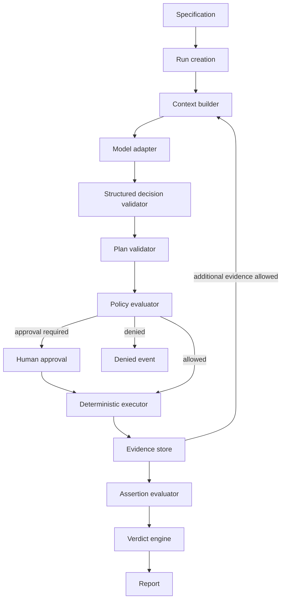
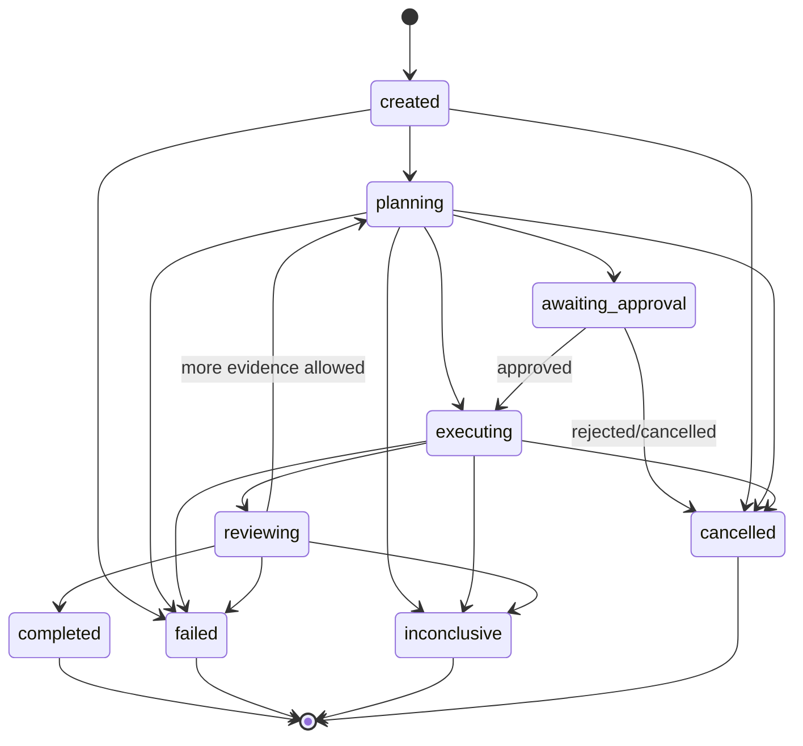

# Arquitectura de FeatureProof

## 1. Propósito

Este documento define la arquitectura de referencia de FeatureProof y las
reglas que deben respetar las features posteriores.

FeatureProof es una plataforma de validación bajo demanda. Un equipo describe
las condiciones que debe cumplir una funcionalidad, la plataforma construye un
plan de validación, ejecuta operaciones autorizadas contra una aplicación
desplegada y entrega un veredicto respaldado por evidencias.

FeatureProof no sustituye a la integración continua ni ejecuta una validación
por cada commit. Cada ejecución comienza mediante una solicitud explícita desde
la CLI, una API o una integración como GitHub.

La primera entrega es un monolito modular escrito en Go. La separación inicial
se realiza mediante paquetes y contratos internos; no mediante microservicios.

## 2. Objetivos arquitectónicos

La arquitectura debe garantizar que:

1. el modelo no pueda ejecutar operaciones fuera de las capacidades
   registradas;
2. una decisión del modelo no constituya por sí misma una prueba;
3. todo veredicto se derive de assertions deterministas y evidencias
   persistidas;
4. cada ejecución tenga límites explícitos de tiempo, pasos, herramientas y
   coste;
5. una ejecución pueda auditarse y reproducirse a partir de su journal;
6. el núcleo pueda probarse sin invocar un modelo real ni servicios externos;
7. la integración con modelos, almacenamiento, GitHub o Kubernetes pueda
   sustituirse sin modificar el dominio;
8. los fallos técnicos se distingan de los incumplimientos funcionales.

## 3. Principios fundamentales

### 3.1 El agente propone; el sistema decide y ejecuta

El modelo puede proponer un plan, solicitar contexto adicional e interpretar
resultados. No puede invocar directamente red, sistema operativo, Kubernetes,
bases de datos ni otros servicios.

Toda acción sigue este recorrido:

```text
decisión del modelo
        ↓
validación estructural
        ↓
resolución de la herramienta
        ↓
evaluación de política
        ↓
comprobación de presupuesto
        ↓
ejecución con cancelación y timeout
        ↓
redacción de datos sensibles
        ↓
persistencia de evidencia
```

### 3.2 Una afirmación necesita evidencia

El modelo no determina si una restricción ha pasado. El motor de veredictos
evalúa assertions deterministas sobre resultados estructurados.

Una restricción solo puede quedar en uno de estos estados:

- `passed`: todas sus assertions obligatorias han pasado;
- `failed`: al menos una assertion obligatoria no se cumple;
- `inconclusive`: no existe evidencia suficiente o fiable;
- `error`: FeatureProof no pudo completar su propio procesamiento.

Un informe no puede presentar `passed` sin referencias a evidencias
persistidas.

### 3.3 Seguro por defecto

Una capacidad no registrada o no permitida está prohibida. Los permisos no se
deducen de la intención del prompt y una herramienta nunca amplía por sí misma
su ámbito.

### 3.4 Determinismo alrededor del modelo

El razonamiento del modelo puede variar. Los contratos, políticas, límites,
assertions, transiciones de estado, persistencia y cálculo del veredicto deben
ser deterministas.

### 3.5 Entrega vertical antes que distribución

La primera versión se ejecuta como un único proceso y persiste en archivos
locales. PostgreSQL, workers remotos, GitHub y Kubernetes se incorporan cuando
el flujo local esté validado. No se crean fronteras de red sin una necesidad
operativa demostrada.

## 4. Flujo de una validación



El flujo se divide en tres fases:

1. **Planificación:** el agente convierte restricciones y contexto en un plan
   estructurado.
2. **Ejecución:** un ejecutor determinista realiza únicamente las acciones
   aprobadas.
3. **Evaluación:** el sistema calcula resultados; el agente puede explicarlos o
   solicitar evidencia adicional dentro de sus límites.

## 5. Componentes y responsabilidades

### 5.1 Specification loader

Carga y valida la especificación proporcionada por el usuario. Es responsable
de sintaxis, versión del formato, campos obligatorios y referencias internas.
No ejecuta lógica agentica.

### 5.2 Harness

Es el orquestador de una ejecución. Sus responsabilidades son:

- aplicar la máquina de estados;
- solicitar decisiones al modelo;
- validar el tipo de decisión recibido;
- coordinar plan, política, aprobación y ejecución;
- controlar los presupuestos;
- propagar cancelación;
- registrar eventos;
- finalizar exactamente una vez.

El harness no contiene implementaciones concretas de modelos, herramientas ni
almacenamiento.

### 5.3 Context builder

Construye una vista acotada del estado que necesita el modelo. Puede incluir:

- objetivo de la ejecución;
- restricciones pendientes;
- herramientas y esquemas disponibles;
- resumen de evidencias obtenidas;
- decisiones de política relevantes;
- presupuesto restante;
- errores recuperables del paso anterior.

Los contenidos de repositorios, especificaciones OpenAPI, respuestas HTTP y
logs se consideran datos no confiables. Nunca se interpretan como instrucciones
del sistema.

### 5.4 Model adapter

Encapsula el proveedor del modelo detrás de una interfaz definida por el
paquete consumidor. Recibe una petición tipada y devuelve una decisión
estructurada.

El adapter es responsable de traducir contratos externos, aplicar timeouts y
clasificar errores del proveedor. No ejecuta herramientas ni modifica el
estado de la ejecución.

Debe existir un modelo falso programable para tests. Los tests del harness no
dependen de una API de modelos real.

### 5.5 Plan validator

Comprueba que el plan:

- referencia restricciones existentes;
- usa herramientas registradas;
- proporciona inputs conformes a sus esquemas;
- contiene assertions evaluables;
- respeta dependencias entre pasos;
- no excede los límites estáticos de la ejecución.

Un plan estructuralmente inválido no llega al policy evaluator.

### 5.6 Tool registry

Mantiene el conjunto explícito de capacidades disponibles. Cada herramienta
declara:

- nombre estable y versionado cuando sea necesario;
- esquema de entrada;
- tipo de salida;
- clasificación de efectos;
- requisitos de permisos;
- comportamiento de timeout e idempotencia.

No existe una herramienta genérica de shell. Las capacidades se modelan con
operaciones específicas como `http.request`, `openapi.inspect` o
`kubernetes.workload_status`.

### 5.7 Policy evaluator

Evalúa una llamada en el contexto de la ejecución y devuelve una decisión
estructurada:

- `allowed`;
- `denied`;
- `approval_required`.

La decisión incluye una razón estable y auditable. El policy evaluator no
ejecuta la operación y no depende de explicaciones en lenguaje natural del
modelo.

### 5.8 Deterministic executor

Ejecuta un plan aprobado paso a paso. Sus responsabilidades son:

- resolver inputs derivados de pasos anteriores;
- aplicar timeout y cancelación;
- evitar una nueva ejecución accidental mediante claves de idempotencia;
- capturar resultados y errores;
- entregar la salida al redactor antes de persistirla;
- emitir un evento por cada transición relevante.

La primera versión ejecuta secuencialmente. Solo se añadirá concurrencia cuando
el plan pueda expresar de forma segura dependencias, aislamiento y orden.

### 5.9 Evidence store

Persiste evidencias inmutables. Una evidencia contiene como mínimo:

- identificador;
- ejecución y paso de origen;
- herramienta y versión;
- instante inicial y duración;
- input saneado;
- output saneado;
- clasificación del error, si existe;
- huella que permita detectar alteraciones.

Las evidencias grandes pueden externalizarse en el futuro, pero sus referencias
y metadatos permanecen en el journal de la ejecución.

### 5.10 Assertion evaluator

Evalúa condiciones concretas sobre outputs estructurados. Las assertions no se
resuelven mediante un modelo.

Las primeras assertions previstas son:

- igualdad de estado HTTP;
- existencia, ausencia o igualdad de un valor JSON;
- coincidencia de cabeceras permitidas;
- duración máxima;
- estado de disponibilidad de un workload.

### 5.11 Verdict engine

Agrega los resultados de assertions y calcula el estado de cada restricción y
de la ejecución. El resultado global no puede ser más favorable que una
restricción crítica fallida o inconclusa según la política de la ejecución.

### 5.12 Report builder

Construye representaciones para humanos y máquinas a partir del estado
calculado. No recalcula assertions ni modifica evidencias. Inicialmente genera
salida de terminal y `report.json`; posteriormente podrá producir un GitHub
Check.

### 5.13 Run store y event journal

El estado actual permite operar; el journal permite explicar cómo se alcanzó.
Cada cambio significativo se registra como evento append-only.

La persistencia local inicial usa:

```text
.featureproof/
  runs/
    <run-id>/
      run.json
      events.jsonl
      plan.json
      evidence/
        <evidence-id>.json
      report.json
```

Una escritura se realiza de forma atómica cuando el sistema de archivos lo
permita. Un evento confirmado no se reescribe.

## 6. Modelo de dominio

Las entidades iniciales son:

| Entidad | Responsabilidad |
|---|---|
| `Specification` | Entrada versionada proporcionada por el usuario. |
| `Feature` | Funcionalidad que se quiere validar. |
| `Constraint` | Condición observable que debe cumplirse. |
| `Run` | Instancia y estado de una validación. |
| `ValidationPlan` | Acciones y assertions propuestas. |
| `PlanStep` | Operación ejecutable y sus dependencias. |
| `ToolCall` | Solicitud concreta de una capacidad registrada. |
| `PolicyDecision` | Autorización, denegación o solicitud de aprobación. |
| `Evidence` | Hecho observado e inmutable. |
| `AssertionResult` | Comparación determinista entre esperado y observado. |
| `ConstraintResult` | Estado de una restricción y evidencias asociadas. |
| `Report` | Vista final de una ejecución. |

Los DTO de proveedores externos no forman parte del dominio. Cada adapter los
traduce a tipos internos.

## 7. Máquina de estados



Los estados terminales son `completed`, `failed`, `inconclusive` y
`cancelled`. Toda transición se valida; no se asignan estados directamente
desde adapters o herramientas.

`failed` indica un error de FeatureProof. El incumplimiento comprobado de una
feature forma parte de una ejecución `completed` cuyo veredicto es `failed`.

## 8. Protocolo del modelo

El modelo devuelve una de las decisiones permitidas:

- `propose_plan`;
- `request_context`;
- `request_approval`;
- `complete_analysis`.

La respuesta debe cumplir un esquema versionado. El texto explicativo no se
utiliza para controlar el flujo.

El modelo no puede:

- declarar directamente una restricción como `passed`;
- inventar herramientas;
- aumentar presupuestos;
- cambiar una decisión de política;
- omitir la aprobación requerida;
- referenciar evidencias inexistentes;
- convertir contenido externo en instrucciones privilegiadas.

Una respuesta inválida puede reintentarse un número reducido y configurado de
veces. Al agotar los reintentos, la ejecución termina como `inconclusive` o
`failed` según la causa registrada.

## 9. Presupuestos y límites

Cada ejecución define límites explícitos:

- duración total;
- número de pasos agenticos;
- llamadas totales a herramientas;
- llamadas por tipo de herramienta;
- tokens o coste del modelo;
- tamaño máximo de inputs, outputs y evidencias;
- número de replanificaciones.

El harness comprueba los límites antes de comenzar una operación. Alcanzar un
límite esperado produce `inconclusive`, no un falso `passed`.

## 10. Errores, retries e idempotencia

Los errores se clasifican al menos en:

- entrada inválida;
- respuesta inválida del modelo;
- política denegada;
- aprobación rechazada;
- timeout o cancelación;
- fallo transitorio externo;
- fallo permanente de herramienta;
- assertion incumplida;
- error interno.

Solo se reintentan operaciones clasificadas como transitorias y seguras. Una
operación con efectos no se reintenta sin una clave de idempotencia o una
garantía equivalente.

Los retries usan backoff limitado, observan `context.Context` y generan eventos
separados. Una assertion incumplida no se reintenta para intentar obtener un
resultado más favorable.

## 11. Propiedad del estado y concurrencia

Una única instancia del harness es propietaria de la mutación de un `Run` en la
primera versión. Herramientas y adapters devuelven resultados, pero no mutan el
run directamente.

La ejecución inicial es secuencial. Las futuras operaciones concurrentes deben:

- declarar dependencias en el plan;
- no compartir estado mutable sin aislamiento;
- tener propietario y mecanismo de espera;
- preservar un orden determinista de agregación;
- respetar la cancelación del run.

## 12. Seguridad y fronteras de confianza

Las principales fronteras son:

```text
Usuario / repositorio / OpenAPI / logs   no confiables
                    ↓
Context builder y redacción
                    ↓
Modelo externo                           no confiable para autorizar
                    ↓
Schema + plan validator + policy         frontera de control
                    ↓
Tool adapters                            acceso mínimo al entorno
                    ↓
Aplicación de validación                 aislada de producción
```

Reglas obligatorias:

- no se entregan secretos al modelo;
- cabeceras de autenticación y campos configurados se redactan;
- cada herramienta recibe credenciales de alcance mínimo;
- el target permitido se fija fuera del prompt;
- las redirecciones HTTP se vuelven a validar;
- se bloquean destinos de red no autorizados;
- un entorno de validación no comparte credenciales con producción;
- no existe ejecución arbitraria de comandos;
- la evidencia conserva utilidad sin exponer datos sensibles.

## 13. Dependencias y dirección del código

Se aplica una arquitectura hexagonal pragmática:

```text
CLI / API / GitHub adapters
            ↓
Application: harness y casos de uso
            ↓
Domain: estados, planes, resultados y reglas
            ↑
Adapters: model, filesystem, HTTP, Kubernetes
```

El dominio no importa SDK de modelos, clientes HTTP concretos, Kubernetes,
GitHub ni bases de datos. Las interfaces se definen en el paquete consumidor,
de acuerdo con `docs/conventions.md`.

No se crean paquetes genéricos `utils`, `common`, `services` o `managers`.

## 14. Organización prevista del código

```text
cmd/
  featureproof/
internal/
  specification/
  harness/
  planning/
  policy/
  executor/
  evidence/
  assertion/
  verdict/
  reporting/
  runstore/
  model/
  tools/
    http/
    openapi/
    kubernetes/
specs/
evals/
examples/
```

Esta es una guía de responsabilidades, no una obligación de crear todos los
paquetes desde el inicio. Un paquete se incorpora cuando existe comportamiento
real y cohesionado que lo justifica.

## 15. Observabilidad

Los logs son estructurados e incluyen `run_id`, `step_id`, `constraint_id` y
`tool_call_id` cuando correspondan. No contienen prompts completos, tokens,
credenciales ni cuerpos sensibles.

Las métricas futuras deben distinguir:

- duración por fase;
- llamadas y errores por herramienta;
- decisiones de política;
- consumo del modelo;
- ejecuciones `passed`, `failed`, `inconclusive` y con error interno;
- tiempo de creación y eliminación de entornos.

El event journal es la fuente principal para auditoría; los logs no son estado.

## 16. Estrategia de pruebas

### 16.1 Tests unitarios

Cubren comportamiento determinista:

- transiciones válidas e inválidas;
- validación de planes;
- límites y presupuestos;
- decisiones de política;
- evaluación de assertions;
- cálculo de veredictos;
- redacción de secretos;
- persistencia y recuperación de eventos.

### 16.2 Tests del harness

Usan un modelo falso con respuestas programadas y herramientas falsas. Deben
incluir:

- recorrido correcto hasta finalización;
- respuesta del modelo mal formada;
- herramienta inexistente;
- política denegada;
- aprobación pendiente o rechazada;
- timeout y cancelación;
- agotamiento de pasos;
- error transitorio y retry;
- intento de finalizar sin evidencia.

### 16.3 Tests de integración

Comprueban adapters contra dependencias controladas, por ejemplo un servidor
HTTP local. No llaman a servicios reales por defecto.

### 16.4 Evals del modelo

Las evaluaciones con un modelo real están separadas de `go test`. Miden
propiedades como:

- planes estructuralmente válidos;
- selección de herramientas apropiadas;
- cobertura de restricciones;
- ausencia de herramientas inventadas;
- resistencia a instrucciones contenidas en datos no confiables;
- capacidad de reconocer evidencia insuficiente.

Una eval no sustituye un test determinista ni se utiliza como única prueba de
una regla de seguridad.

## 17. Evolución prevista

### Etapa 1: harness local

Modelo falso, herramienta falsa, políticas, límites, journal y reportes
locales.

### Etapa 2: validación HTTP

Especificación YAML, herramienta HTTP, assertions deterministas y servidor de
prueba local.

### Etapa 3: modelo real

Adapter de modelo, generación de planes, evaluaciones y aprobación humana.

### Etapa 4: entornos Kubernetes

Namespace aislado por ejecución solicitada, despliegue de imagen, readiness,
TTL y limpieza.

### Etapa 5: integración con GitHub

Activación bajo demanda, contexto de pull request y publicación mediante
GitHub Checks.

La extracción de servicios independientes solo se considera cuando exista una
necesidad demostrada de escalado, aislamiento o despliegue independiente.

## 18. Invariantes arquitectónicas

Toda feature debe preservar estas reglas:

- **ARCH-001:** el modelo no accede directamente a sistemas externos.
- **ARCH-002:** toda herramienta está registrada, tipada y sujeta a política.
- **ARCH-003:** ningún `passed` existe sin evidence IDs válidos.
- **ARCH-004:** el veredicto se calcula fuera del modelo.
- **ARCH-005:** todos los bucles agenticos tienen límites explícitos.
- **ARCH-006:** toda operación bloqueable acepta y propaga contexto.
- **ARCH-007:** el journal registra las transiciones relevantes de forma
  append-only.
- **ARCH-008:** los datos no confiables no se convierten en instrucciones.
- **ARCH-009:** secretos y datos configurados como sensibles se redactan antes
  de persistir o enviar al modelo.
- **ARCH-010:** los tests del harness pueden ejecutarse sin red ni modelo real.
- **ARCH-011:** una política denegada no puede ser anulada por el modelo.
- **ARCH-012:** una herramienta no muta directamente el estado del run.

Una excepción requiere documentarse en el `design.md` de la feature y recibir
aprobación humana antes de implementarse.

## 19. Decisiones aplazadas

Todavía no se fija:

- proveedor o modelo concreto;
- formato definitivo de la specification;
- lenguaje completo de assertions;
- mecanismo de aprobación humana;
- motor de políticas externo o interno;
- base de datos para producción;
- almacenamiento de evidencias grandes;
- modelo de aislamiento multi-tenant;
- protocolo entre control plane y runners remotos.

Estas decisiones se tomarán mediante specs y ADRs cuando una feature las
necesite. No deben anticiparse en la primera implementación del harness.
