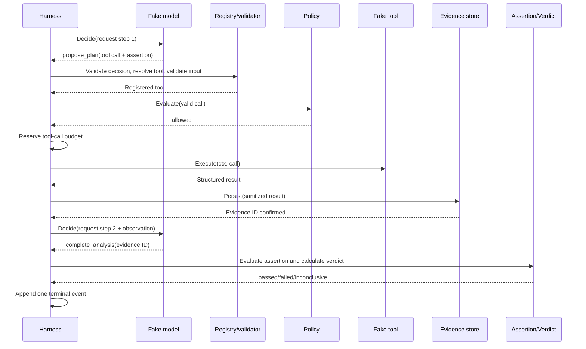

# Agent harness acotado — Design

## Resumen de la solución

La feature introduce un ciclo local y secuencial dirigido por `Harness`. El
harness pide una decisión tipada a un modelo falso, valida un `propose_plan`
con una llamada y una assertion, resuelve la herramienta en un registro,
consulta política, reserva presupuesto y ejecuta la herramienta con el contexto
del run. Cada intento ejecutado se sanea y persiste antes de convertirse en una
observación disponible para el siguiente paso del modelo. Cuando el modelo
devuelve `complete_analysis`, el harness evalúa la assertion sobre evidencias
persistidas y calcula el veredicto mediante reglas deterministas.

El modelo propone; no recibe handles de herramientas, no ejecuta operaciones y
no establece estados, resultados de assertions ni veredictos. Una única
instancia del harness posee el estado mutable del run y finaliza exactamente una
vez.

## Fuentes de contexto consultadas

| Fuente | Evidencia utilizada |
|---|---|
| `AGENTS.md` | Alcance de producto, flujo SDD y restricción de una feature por sesión. |
| `feature_list.json`, feature `id=1` | Camino feliz con modelo falso, orden de controles, persistencia de evidencia, veredicto determinista, rechazo auditable, límite de pasos y tests sin red. |
| `.codex/agents/spec.md` | Contenido obligatorio y límites del trabajo de spec. |
| `docs/specs.md` | Formato EARS, aprobación humana y trazabilidad `R → task → test`. |
| `docs/architecture.md` | Responsabilidades del harness, protocolo del modelo, estados, presupuestos, journal, seguridad, cancelación, retries e invariantes ARCH-001 a ARCH-012. |
| `docs/conventions.md` | Paquetes cohesionados, interfaces del consumidor, contexto, errores tipados, tiempo controlable, observabilidad y tests deterministas. |

No se consultaron repositorios, APIs ni documentación externa. El repositorio
no contiene todavía contratos de aplicación o código con el que mantener
compatibilidad.

## Reglas arquitectónicas aplicadas

- ARCH-001, ARCH-002 y ARCH-011: el modelo solo emite datos; registry, schema y
  policy forman la frontera de autorización.
- ARCH-003 y ARCH-004: el evaluador solo acepta evidence IDs recuperables y el
  veredicto se calcula fuera del modelo.
- ARCH-005 y ARCH-006: pasos, llamadas y retries son acotados; todas las
  fronteras bloqueables reciben `context.Context`.
- ARCH-007: eventos confirmados son append-only y permiten auditar la secuencia.
- ARCH-008 y ARCH-009: outputs son datos no confiables, se sanean antes de
  persistirse o volver al modelo.
- ARCH-010: todas las dependencias externas se sustituyen por fakes locales.
- ARCH-012: las herramientas devuelven resultados; solo el harness muta el run.
- CONV-001 a CONV-009: nombres internos en inglés, interfaces mínimas en el
  consumidor, errores distinguibles, reloj inyectado y tests trazables.

No se propone ninguna excepción a arquitectura o convenciones.

## Áreas y paquetes afectados

La organización es una guía para mantener responsabilidades cohesionadas; no
obliga a crear paquetes sin comportamiento.

| Paquete previsto | Responsabilidad |
|---|---|
| `internal/harness` | Caso de uso, estado del run, protocolo interno, presupuestos, secuencia de validación y puertos consumidores. |
| `internal/model` | Fake model programable que implementa el puerto consumido por el harness. |
| `internal/tools` | Contrato de herramienta, metadatos, validación de input, registry y fake tools. |
| `internal/policy` | Evaluador local determinista y razones estables `allowed`/`denied`. |
| `internal/evidence` | Modelo inmutable, saneado y persistencia local recuperable. |
| `internal/assertion` | Assertion mínima sobre outputs estructurados y sus resultados. |
| `internal/verdict` | Agregación determinista de assertion results y evidence IDs. |
| `internal/runstore` | Journal local append-only y lectura de eventos del run. |

`cmd/` no necesita cambios para demostrar esta feature. Las interfaces para
modelo, herramientas, evidencia, journal, política y reloj pertenecen al
paquete consumidor que necesita sustituirlas.

## Componentes y responsabilidades

### Harness

- valida configuración y dependencias al construirse;
- crea el run y emite su evento inicial;
- posee el contador de pasos, llamadas y retries;
- solicita y valida decisiones del modelo;
- coordina registry, policy, presupuesto, tool, sanitizer y stores en el orden
  definido;
- pasa únicamente observaciones persistidas al modelo;
- invoca assertion y verdict evaluators;
- aplica transiciones tipadas y emite exactamente un evento terminal.

### Fake model

Mantiene una cola programada de respuestas para tests y captura cada petición
recibida. Implementa una única operación cancelable. No conoce registry,
policy, stores ni herramientas.

### Decision validator y tool registry

El validador acepta solamente decisiones versionadas conocidas y comprueba los
campos requeridos. Para `propose_plan`, valida referencias de restricción,
identidad de llamada, nombre, input y assertion. El registry resuelve por un
nombre estable y expone metadatos: esquema de input, clasificación de efectos y
requisito de idempotencia. No existe fallback ni herramienta genérica.

### Policy evaluator

Recibe run, restricción y llamada ya válidos y produce una decisión tipada con
razón estable. Para esta entrega implementa `allowed` y `denied`;
`approval_required` queda fuera de alcance y no se degrada implícitamente a
`allowed`.

### Budget

El run contiene límites y consumo de pasos, llamadas y retries. El harness
reserva una unidad antes de comenzar la operación correspondiente. Una reserva
no puede dejar el presupuesto negativo. El contador de pasos se incrementa por
cada petición emitida al modelo.

### Tool executor y sanitizer

La herramienta recibe contexto y una llamada validada; devuelve un resultado
tipado y no conoce el run. El harness aplica el sanitizer al input y resultado
antes de persistir. Los fakes declaran si tienen efectos y si cuentan con una
garantía de idempotencia para decidir retries.

### Evidence store

Persiste un registro por cada intento de herramienta que llegó a ejecutarse,
incluidos resultados técnicos fallidos. La evidencia usa un ID generado fuera
de la herramienta e incluye origen, tiempos controlados, datos saneados y
clasificación del error. Una escritura confirmada no se modifica. La primera
implementación local puede usar un archivo por evidencia bajo el directorio del
run y escritura temporal seguida de reemplazo atómico cuando el filesystem lo
permita.

### Assertion evaluator y verdict engine

El evaluador recibe una assertion interna y evidencias recuperadas. La assertion
mínima de esta entrega compara de forma determinista un valor esperado con un
campo de output estructurado; no pretende fijar el lenguaje definitivo. El
verdict engine aplica:

- assertion obligatoria satisfecha con evidencia: `passed`;
- assertion obligatoria incumplida con evidencia: `failed`;
- evidencia ausente/no fiable o límite esperado: `inconclusive`;
- fallo interno del procesamiento: `error`.

Un resultado `passed` siempre incluye al menos un evidence ID recuperable.

### Event journal

Anexa eventos con un número de secuencia monotónico por run. El journal es la
fuente de auditoría y no se reconstruye desde logs. Los stores no deciden
transiciones del run.

## Contratos y datos propuestos

Los nombres son conceptuales y podrán ajustarse sin cambiar el comportamiento.

### Petición y decisión del modelo

`ModelRequest` contiene `run_id`, número de paso, objetivo, restricción
pendiente, descriptores de herramientas permitidas, presupuesto restante y
observaciones persistidas saneadas. No contiene ejecutores ni credenciales.

`ModelDecision` es una unión discriminada versionada:

- `propose_plan`: una llamada con `tool_call_id`, herramienta, input,
  constraint ID y assertion determinista;
- `complete_analysis`: solicitud de evaluar con los evidence IDs conocidos.

Las demás decisiones previstas por arquitectura (`request_context` y
`request_approval`) no se implementan en esta entrega; si aparecen se tratan
como decisión no soportada y nunca ejecutan una operación.

### Estado del run

```text
Run
  id
  status
  objective
  constraint
  limits { max_steps, max_tool_calls, max_retries }
  consumed { steps, tool_calls, retries }
  evidence_ids[]
  verdict?
```

Los límites deben ser explícitos y no negativos; un run sin capacidad para un
trabajo solicitado termina de acuerdo con el límite correspondiente.

### Evidencia

```text
Evidence
  id
  run_id
  step_id
  tool_call_id
  tool_name
  started_at
  duration
  sanitized_input
  sanitized_output
  error_class?
  integrity_hash
```

El hash cubre la representación canónica persistida excluyendo el propio hash.
Su objetivo en esta entrega es detectar alteraciones accidentales al recuperar,
no ofrecer firma criptográfica de un tercero.

### Eventos mínimos

- `run_created`, `planning_started`, `model_decision_received`;
- `tool_call_validated`, `policy_evaluated`, `budget_reserved`;
- `tool_execution_started`, `tool_execution_finished`, `evidence_persisted`;
- `tool_call_rejected` con `unknown_tool`, `policy_denied`,
  `budget_exhausted` o `invalid_structure`;
- `retry_scheduled` con número de intento y clasificación;
- `assertion_evaluated`, `verdict_calculated`;
- un único `run_completed`, `run_inconclusive`, `run_failed` o
  `run_cancelled`.

Los eventos incluyen los IDs aplicables; las razones se modelan como valores
tipados, no como comparaciones de texto.

## Flujo principal



## Flujos de error

1. **Decisión o input inválido:** se emite rechazo estructural; no se resuelve
   una implementación, no se consulta policy y no se consume tool budget. El
   harness puede pedir una corrección solo si la clasificación es recuperable y
   quedan pasos.
2. **Herramienta desconocida:** registry falla de forma tipada, se emite
   `unknown_tool` y nunca se ejecuta una alternativa.
3. **Política denegada:** se conserva la razón estable y se emite rechazo; el
   modelo no puede sobrescribirla.
4. **Presupuesto agotado:** no comienza la operación; el run termina
   `inconclusive`.
5. **Fallo técnico de herramienta:** el intento ejecutado se persiste como
   evidencia con error. Solo un fallo transitorio seguro puede reintentarse.
6. **Fallo de persistencia:** el resultado no confirmado no entra en contexto
   ni en assertions; el run termina `error`.
7. **Finalización sin evidencia:** el modelo puede solicitarla, pero el verdict
   engine devuelve `inconclusive`.
8. **Error interno:** se conserva la causa en un error tipado, se intenta
   registrar el terminal `run_failed` una sola vez y no se emite `passed`.

## Estados y transiciones

Para este alcance se usa el subconjunto de la máquina aprobada:

```text
created -> planning -> executing -> reviewing -> completed
   |          |            |            |
   +----------+------------+------------+-> failed
   +----------+------------+------------+-> inconclusive
   +----------+------------+------------+-> cancelled
```

`completed` significa que FeatureProof terminó su evaluación; su veredicto
puede ser `passed` o `failed`. `failed` como estado del run se reserva a error
interno. Todos los estados terminales bloquean nuevas transiciones. El harness
es el único que aplica transiciones y las registra antes de devolver.

## Propiedad del estado y concurrencia

La primera versión es enteramente secuencial: como máximo hay una decisión de
modelo o una ejecución de herramienta activa. El harness posee el `Run` y no lo
comparte para mutación con adapters ni stores. No son necesarias goroutines
internas; un fake bloqueable puede coordinarse desde el test, con el test como
propietario de cualquier goroutine y con espera explícita. Este diseño evita
orden no determinista de eventos y evidencias.

## Cancelación

`context.Context` es el primer parámetro en modelo, herramienta y persistencia.
El harness propaga el contexto recibido sin almacenarlo ni sustituirlo. Antes
de pedir un nuevo paso o retry comprueba cancelación. Si se cancela durante una
operación, espera a que el contrato bloqueable retorne, conserva los registros
ya confirmados y emite una única terminación `cancelled`. Una evidencia cuya
persistencia no fue confirmada no se anuncia al modelo ni se usa en assertions.

## Retries e idempotencia

- Solo se reintentan errores clasificados explícitamente como transitorios.
- Cada retry reserva presupuesto y genera su propio par de eventos e evidencia
  de intento cuando la ejecución alcanzó la herramienta.
- Herramientas sin efectos pueden reintentarse dentro del máximo configurado.
- Herramientas con efectos requieren una clave o garantía de idempotencia
  declarada; en su ausencia, el fallo no se reintenta.
- El backoff se obtiene de una política acotada y un reloj/espera inyectables;
  observa cancelación y los tests avanzan tiempo sin `time.Sleep`.
- Assertions incumplidas, denegaciones y errores estructurales no se reintentan
  como operaciones de herramienta.

## Observabilidad

El journal append-only contiene la evidencia de control: decisiones, orden de
checks, reservas, intentos, persistencia y terminal. Los logs estructurados son
diagnóstico adicional e incluyen `run_id`, `step_id`, `constraint_id` y
`tool_call_id` cuando existan. No contienen prompts completos, credenciales ni
datos previos al saneado. Los tests verifican eventos y stores; no dependen de
mensajes de log.

## Estrategia de pruebas

Los tests usan fakes programables, reloj y espera controlados, IDs
deterministas y directorios temporales. Ningún test abre sockets, consulta DNS,
lee credenciales o llama un modelo real. Los nombres previstos son contratos de
trazabilidad y podrán organizarse en tablas cuando compartan setup.

| Requirement | Componente | Prueba prevista |
|---|---|---|
| R1 | `harness`, fake model/tool | `TestHarnessReturnsPersistedToolObservationToModel` |
| R2 | decision/input validator | `TestHarnessRejectsMalformedDecisionBeforePolicyAndExecution` |
| R3 | registry y policy | `TestHarnessExecutesOnlyRegisteredAllowedTool`; `TestHarnessAuditsUnknownAndDeniedTools` |
| R4 | budget | `TestHarnessReservesToolBudgetBeforeExecution`; `TestHarnessStopsWhenToolBudgetIsExhausted` |
| R5 | evidence store y sanitizer | `TestHarnessPersistsRelatedEvidenceBeforeUse`; `TestHarnessFailsWhenEvidenceCannotBePersisted`; `TestFileEvidenceStoreDoesNotRewriteConfirmedEvidence` |
| R6 | assertion y verdict | `TestVerdictIsDerivedFromPersistedEvidence`; `TestVerdictCannotPassWithoutEvidence`; `TestVerdictIgnoresModelClaim` |
| R7 | step loop | `TestHarnessStopsAtConfiguredStepLimit` |
| R8 | journal y state transitions | `TestJournalAuditsDecisionOrder`; `TestHarnessEmitsExactlyOneTerminalEvent` |
| R9 | harness y bloqueables falsos | `TestHarnessPropagatesCancellationAndPreservesConfirmedRecords` |
| R10 | retry policy | `TestHarnessRetriesOnlyTransientIdempotentOperationsWithinBudget`; `TestHarnessPersistsEveryExecutedAttempt` |
| R11 | suite completa | `TestHarnessSuiteUsesOnlyControlledLocalDependencies` y ejecución de la suite con red no requerida |

Además, tests unitarios cubren transiciones terminales inválidas, razones de
error tipadas, hash al recuperar evidencia y orden monotónico del journal. Una
prueba de integración local usa el filesystem temporal para demostrar
persistencia y recuperación; sigue siendo hermética y sin red.

## Alternativas y decisiones

- **Un único paquete para toda la feature:** descartado porque mezclaría
  orquestación, policy, persistencia y evaluación. Se mantienen fronteras
  pequeñas sin crear capas vacías.
- **Permitir que el modelo devuelva el veredicto:** descartado por ARCH-003 y
  ARCH-004; sus textos solo son datos no autoritativos.
- **Persistir solo el último intento exitoso:** descartado porque perdería la
  auditoría de resultados ejecutados y retries.
- **Ejecutar llamadas concurrentes:** descartado en la primera versión para
  preservar propiedad simple del estado y orden determinista.
- **Usar un mock de SDK de modelo:** descartado; el fake implementa el contrato
  interno y evita fijar un proveedor aplazado.
- **Crear un lenguaje general de assertions:** aplazado. Una comparación mínima
  estructurada permite probar el motor sin anticipar el formato definitivo.
- **Reintentar por defecto:** descartado. Solo errores transitorios y operaciones
  seguras consumen retries configurados.

## Mapa de trazabilidad inicial

| Requirement | Tasks | Resultado verificable |
|---|---|---|
| R1 | T2, T6, T7 | El fake propone una llamada y recibe la evidencia persistida. |
| R2 | T2, T4, T6, T7 | Una decisión/input inválido no alcanza policy ni tool. |
| R3 | T4, T6, T7 | Solo una herramienta registrada y permitida se ejecuta; rechazos quedan auditados. |
| R4 | T1, T4, T6, T7 | La reserva precede a la ejecución y el agotamiento termina inconcluso. |
| R5 | T3, T5, T6, T7 | Cada intento ejecutado produce evidencia relacionada y recuperable antes de usarse. |
| R6 | T5, T6, T7 | Assertions y veredicto dependen de evidencia persistida. |
| R7 | T1, T6, T7 | El número de peticiones nunca supera el máximo. |
| R8 | T1, T3, T6, T7 | El journal conserva orden y exactamente un terminal. |
| R9 | T6, T7 | La cancelación alcanza dependencias y conserva confirmaciones. |
| R10 | T3, T4, T6, T7 | Retries seguros, acotados y auditados por intento. |
| R11 | T2, T3, T4, T5, T6, T7 | La suite completa es determinista, local y sin modelo real. |
