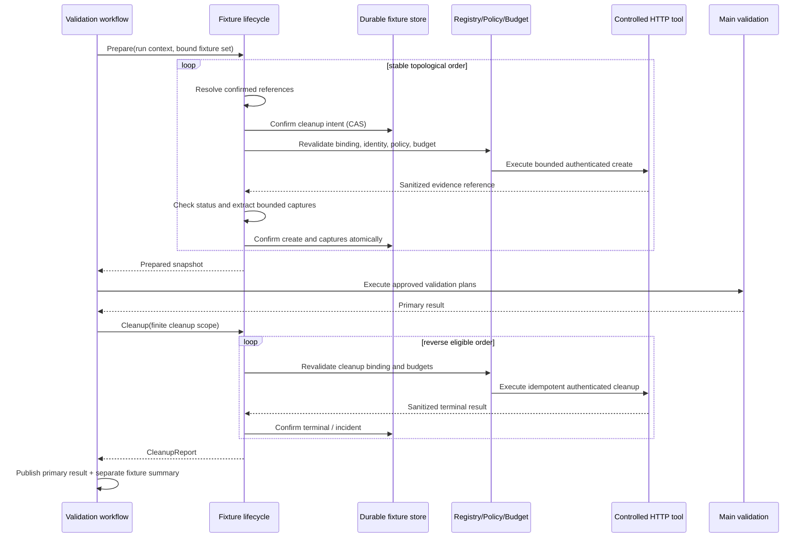

# Preparación y limpieza de fixtures mediante API — Design

## Resumen de la solución

La feature incorpora un paquete cohesionado `internal/fixture` propietario del
modelo validado, grafo, capturas y máquina de lifecycle. `internal/specification`
añade el contrato v3 y lo traduce a ese modelo sin ejecutar efectos. Durante
composición, un binder une cada operación a target, catálogo de contrato
aprobado, policy de idempotencia e identidad. El resultado es un snapshot
inmutable sellado con los mismos digests de revisión y configuración que el
workflow.

El workflow ejecuta una fase `preparing_fixtures` antes de los planes. Cada
create se procesa secuencialmente con la herramienta HTTP controlada. Antes de
permitir I/O confirma durablemente un cleanup intent. Tras una respuesta
aceptada, extrae y sanea solo las capturas declaradas, las confirma y habilita
el siguiente fixture. Al terminar o abortar la fase principal entra en
`cleaning_fixtures`: usa un scope finito suministrado por composición, recorre
los intents elegibles en orden inverso y continúa aunque un cleanup falle.

El primary result se sella antes de agregar `CleanupReport`; ambos se almacenan
y publican como secciones distintas. El lifecycle nunca calcula assertions,
no entrega respuestas al modelo y no puede convertir una incidencia operativa
en `passed` o `failed` funcional.

## Fuentes de contexto consultadas

| Fuente | Evidencia utilizada |
|---|---|
| `AGENTS.md`, `.codex/agents/spec.md`, `docs/specs.md` | Una feature SDD, tres artefactos, EARS, trazabilidad y aprobación humana. |
| `feature_list.json`, feature 26 | Create/cleanup HTTP autorizados, captures, identidades, orden inverso, cleanup finito, idempotencia, resultado separado y matriz de tests. |
| `docs/architecture.md` | El agente propone y el sistema autoriza; tool registry/policy/budget; executor determinista; evidence/journal; cancelación; retries e idempotencia. |
| `docs/conventions.md` | Interfaces consumidor-owned, errores tipados, contextos, concurrencia, reloj, secretos, comentarios y tests deterministas. |
| `specs/validation-specification/*`, `internal/specification/*` | Versiones estrictas v1/v2, target único, límites y validación por field path. |
| `specs/test-identities/*`, `internal/testidentity/*` | Identidades explícitas, bindings exactos, resolución tardía, leases, transporte autenticado y redacción. |
| `specs/multi-step-validation-plan/*`, `internal/planning/*` | Grafo acíclico, orden topológico estable, referencias tipadas, bloqueo y separación entre output confirmado y input. |
| `specs/http-tool/*`, `internal/tools/http/*` | Scope de target, método/path, redirects, request/response bounds, cancelación y ausencia de URLs arbitrarias. |
| `internal/evidence/*`, `internal/harness/*` | Saneado antes de persistencia, records inmutables, journal append-only, budgets y clasificación operacional. |
| `internal/localvalidation/*`, `internal/validationworkflow/*` | Runner compartido, admission snapshot, leases/CAS, recovery, paquete verificable y superficies productivas. |
| `specs/generated-contract-review/*`, `internal/contractreview/*` | Autoridad del catálogo aprobado frente a catálogos derivados no aprobados. |

No se consultó documentación externa. Todos los contratos son internos y la
única frontera de red reutiliza la herramienta HTTP ya aprobada.

## Contratos externos observados

### Specification YAML v3

El loader primero discrimina versión. Los DTO privados v1/v2 no cambian. El DTO
v3 conserva la forma v2 y añade `fixtures`. La decodificación sigue rechazando
unknown fields y duplicate keys. Los datos se traducen a modelos propios; YAML,
`net/http` y DTOs de adapters no cruzan al dominio.

Una operación de fixture contiene:

- `operation`: método y path template; capability y target se fijan como
  `http.request` y el target único de la specification;
- `identity_id`: selección obligatoria no secreta;
- `input`: árbol estricto de literales JSON y referencias de fixture;
- `accepted_statuses`: conjunto explícito, no vacío y sin duplicados;
- `idempotency: contract`: exige garantía aprobada, no aporta la clave.

Una captura contiene `name`, path por segmentos de campo/índice, `value_type` y
`max_bytes`. El selector se evalúa sobre el output saneado y no truncado del
HTTP tool. La respuesta HTTP completa no se convierte en output del fixture.

### Contrato aprobado e idempotencia

El binder consume `contractcatalog.Catalog` aprobado y la policy de proyección
vigente. Resuelve método/path con igualdad estructural. Catálogos derivados sin
decisión humana no tienen autoridad determinista. Un `OperationBinding` incluye
catalog digest, repository, revision, target, método, path template y una
declaración de idempotencia aprobada.

La garantía puede ser una semántica idempotente explícita del contrato o una
ubicación de idempotency key permitida por configuración/contrato. El lifecycle
deriva una key estable de run, fixture y fase mediante una fábrica inyectada;
solo el adapter HTTP interno la aplica. El árbol de input, el modelo y las
superficies no pueden aportar o observar esa key. Si no existe garantía, el
binder falla cerrado.

### Resultado observable

El resultado del workflow añade, sin mezclar categorías:

```text
FixtureSummary {
  fixture_set_digest
  preparation_status: not_required | prepared | failed | cancelled
  fixtures[]: { fixture_id, create_status, confirmed_capture_names[] }
  cleanup: CleanupReport
}

CleanupReport {
  status: not_required | succeeded | partial | failed | deadline_exceeded
  incidents[]: { fixture_id, phase, attempt, category, binding_digest }
}
```

No contiene inputs, bodies, valores capturados, credential refs, secretos,
idempotency keys ni errores externos. El primary result existente conserva su
tipo y autoridad.

## Componentes y responsabilidades

### `internal/specification`

Añade DTO-neutral `Fixture`, `FixtureOperation`, `CaptureDeclaration`,
`FixtureInput` y `FixtureReference`. El validador comprueba forma local, IDs,
uniones, statuses y relaciones que no requieren catálogo. Versiones 1/2
rechazan fixtures; v3 valida identities y fixtures. El loader no resuelve
contratos, identidades, capturas ni red.

### `internal/fixture`

Paquete propietario de la feature:

- `SetValidator`: copia profunda, valida grafo/referencias y calcula órdenes;
- `Binder`: une operaciones con target, catálogo aprobado, identidad e
  idempotencia y produce `BoundSet` inmutable;
- `Lifecycle`: máquina secuencial de prepare/cleanup;
- `CaptureExtractor`: selecciona, clasifica, limita y entrega valores al
  sanitizer antes de confirmarlos;
- `InputResolver`: reemplaza referencias desde `CaptureStore` confirmado y
  produce una copia de input;
- `CleanupScopeFactory`: puerto de aplicación que entrega un contexto finito
  desde autoridad de composición, incluso si el run context terminó;
- `Store`: puerto durable para set binding, intents, captures saneadas,
  attempts y terminales mediante CAS/append-only;
- `Observer`: recibe records allowlisted sin payload;
- `Error`: categorías y fases estables, con causas publicables restringidas.

El paquete no carga YAML, no lee environment/files, no conoce CLI/GitHub y no
crea clientes HTTP propios.

### `internal/tools/http` y `internal/testidentity`

La ejecución reutiliza `http.request`. Se añade la mínima entrada interna para
aplicar path parameters e idempotency material ya autorizados sin aceptar URL
absoluta o headers reservados desde el plan. Registry, validator, policy,
request bounds, target scope, redirects, DNS/dial y authenticated transport
siguen en el mismo orden. Cada intento resuelve de nuevo la identidad y libera
su lease.

El lifecycle recibe un `FixtureHTTPExecutor` mínimo definido por el consumidor;
la composición lo adapta al registry/policy/budget existente. No llama al tool
con autoridad adicional ni evita la validación defensiva de `Execute`.

### Evidence, journal y stores

Un create/cleanup que alcanza respuesta produce evidencia HTTP saneada y
sellada. Captures se extraen solo de evidence confirmada y se guardan en un
store privado ligado a run/fixture/capture/binding; las vistas y eventos guardan
solo nombres y digests. Una captura sensible o no saneable falla antes de
confirmación.

El journal registra `fixture_set_bound`, `cleanup_intent_confirmed`,
`fixture_create_started`, `fixture_create_terminal`, `capture_confirmed`,
`fixture_cleanup_started`, `fixture_cleanup_terminal` y
`fixture_cleanup_report_confirmed`. Cada evento incluye IDs, ordinal, binding
digest, evidence IDs permitidos y categoría, nunca payload.

### Workflow y superficies

`validationworkflow` incorpora las fases de fixture alrededor del runner y
guarda el binding de fixture en `AdmissionSnapshot`/artefacto privado. Recovery
revalida revisión, catálogo, identity catalog, policy y digests antes de I/O.
`localvalidation` usa el mismo lifecycle.

CLI, API, MCP y GitHub siguen seleccionando aliases/configuración ya autorizada
y consumen el mismo service. Sus schemas no aceptan fixtures inline, URLs,
credentials, credential refs, idempotency keys ni comandos. Las respuestas
proyectan `FixtureSummary` seguro.

## Paquetes afectados

```text
internal/specification/          # modelos v3, validación y DTO YAML v3
internal/fixture/                # grafo, binding, lifecycle, captures, store y errores
internal/contractcatalog/        # lectura mínima de idempotencia aprobada si falta en el contrato propio
internal/testidentity/           # reutilización de bindings/transporte por operación
internal/tools/http/             # adaptación interna de path params e idempotency autorizada
internal/evidence/               # tratamiento de captures y records de fixture
internal/harness/                # metadata/eventos seguros y budgets reservados
internal/planning/               # solo frontera para capturas aprobadas, sin convertir fixtures en pasos
internal/localvalidation/        # composición y ejecución local compartida
internal/validationworkflow/     # fases, persistencia, recovery y resultado separado
internal/externalagent/          # vistas/schemas seguros si la proyección los requiere
internal/githubpr/               # paridad mediante workflow, sin autoridad desde texto PR
cmd/featureproof/                # wiring de límites, scope factory y stores autorizados
```

La distribución exacta puede variar si conserva ownership y evita ciclos. No se
añaden adapters shell, database, cloud ni un servicio distribuido.

## Flujo principal



## Flujos de error

1. **V3 o grafo inválido:** rechazo antes de catálogo, modelo, resolver y red.
2. **Contrato/identity/idempotencia inválidos:** composición fail-closed; no se
   admite el run.
3. **Intent no confirmado:** create no cruza red.
4. **Create rechazado antes de I/O:** fixture no se marca creado; se cierra el
   intent sin fabricar cleanup.
5. **Create incierto tras I/O:** intent permanece elegible; cleanup intenta
   resolverse con captures confirmadas o registra input unavailable.
6. **Status create no aceptado/capture inválida:** preparación falla de forma
   operativa, bloquea fase principal y comienza cleanup inverso.
7. **Primary failed/inconclusive/error/cancelled:** se conserva ese resultado y
   se inicia cleanup con scope propio.
8. **Cleanup individual falla:** se confirma incidencia y se continúa con el
   siguiente elegible.
9. **Cleanup scope/budget agotado:** restantes quedan con terminal seguro
   `cleanup_budget_exhausted`/`cleanup_deadline_exceeded`; no hay goroutines.
10. **Persistencia/redacción falla:** no se confirma capture ni éxito; el intent
    queda recuperable y ninguna vista publica payload parcial.
11. **Drift/tampering en recovery:** cero I/O y estado operacional seguro.

## Estados y transiciones

Estado por fixture:

```text
declared -> bound -> cleanup_intent_confirmed -> create_started
create_started -> prepared
create_started -> create_failed
create_started -> create_uncertain
bound -> create_rejected_pre_io

prepared/create_failed/create_uncertain -> cleanup_pending
cleanup_pending -> cleanup_started
cleanup_started -> cleaned
cleanup_started -> cleanup_incident
cleanup_incident -> cleanup_started       (retry permitido)
cleanup_pending/cleanup_incident -> cleanup_exhausted
```

Solo `prepared` habilita dependientes y la fase principal. `create_failed` y
`create_uncertain` pueden ser cleanup-eligible si I/O fue posible. Todo estado
terminal se confirma con CAS y evento append-only; adapters no asignan estados.

Estado agregado:

```text
not_required | validating | preparing | prepared | preparation_failed
             | cleaning | cleaned | cleanup_partial | cleanup_failed
```

El primary workflow conserva su propia máquina. El estado de cleanup es una
dimensión separada, no una transición funcional retrospectiva.

## Propiedad del estado

- `Specification` posee declaraciones no ejecutables y sin secretos.
- `BoundSet` posee copias inmutables, órdenes y digests de bindings.
- `validationworkflow` posee el lifecycle y es el único mutador lógico del run.
- `FixtureStore` posee intents, captures saneadas y terminales confirmados.
- Cada intento posee input resuelto, request, evidence y credential lease; no
  comparte buffers entre fixtures o retries.
- El HTTP tool posee request/response acotados durante una llamada.
- El secret resolver posee credenciales; fixture, harness y stores nunca las
  reciben.
- `CleanupReport` posee solo proyección allowlisted de resultados operativos.

## Concurrencia y cancelación

Prepare y cleanup son secuenciales. El workflow usa el lease/CAS existente para
un único owner; no mantiene locks durante network, disk callbacks o timers.
Tras adquirir o renovar ownership revalida contexto y binding antes del efecto.
Una redelivery observa terminales confirmados y no repite el intento lógico.

El run context se propaga por prepare y la fase principal. Para cleanup, la
composición proporciona `CleanupScopeFactory.New(parentShutdownScope, runID,
deadline)`; el factory no deriva del contexto de run ya cancelado y tampoco usa
un background oculto. El scope posee deadline obligatoria, cancel explícito y
owner que espera su terminación. Cada operación hija respeta la deadline menor
entre scope y timeout HTTP.

No se crean goroutines desde constructores. Si backoff o heartbeat necesitan
espera, usan puertos cancelables y reloj inyectado. Tests coordinan con barriers
y channels, no `time.Sleep`.

## Retries e idempotencia

No hay retry oculto en HTTP, identity transport, extractor o store. Lifecycle
es el único propietario de retries de fixture. Antes de cada intento reserva
call/retry budget, revalida digests, identity/policy/context y usa la misma key
lógica para run+fixture+phase. Cada intento recibe un ordinal distinto y evento
terminal.

Solo categorías transitorias son reintentables y solo cuando el binding acredita
idempotencia. Status no aceptado, capture inválida, input unavailable, policy
denied, identidad permanente, drift, corrupción y redacción fallida son
permanentes. Backoff está limitado por configuración y cleanup deadline. Una
respuesta confirmada no se reejecuta tras recovery.

## Observabilidad

`FixtureAttemptRecord` contiene run/workflow ID, fixture ID, phase, ordinal,
operation-binding digest, identity ID, start/duration, outcome, category y
evidence ID permitido. `CaptureRecord` contiene nombre, type, byte count y
digest; no valor. `CleanupReport` contiene incidencias terminales ordenadas.

Logs, métricas, CLI, API, MCP, GitHub, report y package usan allowlists. No
incluyen request/response bodies, URLs completas, query values, captures,
credential refs, leases, idempotency keys ni error strings externas. El
sanitizer actúa antes de capture extraction/persistence y vuelve a actuar al
proyectar datos al modelo o exterior.

## Convención de documentación del código

Toda entidad, constante, función, método y helper nuevo o modificado, exportado
o interno, tendrá un comentario breve que explique su responsabilidad dentro de
FeatureProof y la frontera o invariante que protege. La regla incluye DTOs,
adapters, fakes, fixtures programáticas, callbacks, factories y helpers de test.
Los comentarios se actualizarán con la responsabilidad y no repetirán solo el
nombre, parámetros o sintaxis.

## Estrategia de pruebas

Los tests ordinarios son herméticos: loader con fixtures locales, catálogo e
identidades fakes, HTTP server local controlado, resolver con canarios, store
temporal, reloj/barriers y workflow/modelo falsos. No leen secrets reales,
environment, DNS público, bases de datos, shells ni servicios externos.

| Requirement | Componentes | Pruebas previstas |
|---|---|---|
| R1 | specification/YAML | `TestV3LoadsStrictFixtureDeclarations`; `TestV1V2CompatibilityRemainsFixtureFree`; `TestV3RejectsUnknownDuplicateAndInvalidFixtureFields` |
| R2 | binder/catalog/http | `TestFixtureOperationsRequireExactApprovedContractBindings`; `TestFixtureInputsCannotSelectToolsTargetsOrArbitraryURLs` |
| R3 | set validator | `TestFixtureGraphProducesStableCreateAndReverseCleanupOrder`; `TestFixtureGraphRejectsCyclesAndImplicitReferenceDependencies` |
| R4 | lifecycle/input resolver | `TestPreparationUsesConfirmedCapturesAndBlocksDependentWork`; `TestPreparationFailureStartsCleanupWithoutValidationPlans` |
| R5 | extractor/store/evidence | `TestCapturesAreTypedBoundedSanitizedAndDurable`; `TestInvalidOrSensitiveCapturesNeverBecomeReferences` |
| R6 | identity/http | `TestCreateAndCleanupUseTheirExplicitAuthorizedIdentities`; `TestFixtureCredentialsNeverCrossPublishableBoundaries` |
| R7 | store/recovery | `TestCleanupIntentPrecedesEveryPossibleCreateEffect`; `TestRecoveryCleansConfirmedAndUncertainCreatesWithoutRepeatingCreate` |
| R8 | lifecycle | `TestCleanupRunsInReverseAfterEveryPrimaryOutcome`; `TestCleanupContinuesAfterPartialFailureAndMissingCapture` |
| R9 | scope/budgets | `TestCancelledRunUsesFiniteOwnedCleanupScope`; `TestCleanupDeadlineAndBudgetsTerminateAllWork` |
| R10 | retry/idempotency | `TestFixtureRetryRequiresVerifiedIdempotencyAndStableKey`; `TestTransientRetriesRevalidateWhilePermanentFailuresDoNotRetry` |
| R11 | result/package | `TestCleanupIncidentsNeverChangePrimaryResult`; `TestCleanupReportCannotClaimUnconfirmedSuccess` |
| R12 | workflow/adapters/redaction | `TestFixtureLifecycleParityAcrossCLIAPIMCPAndGitHub`; `TestFixtureCanariesNeverCrossDurableOrExternalSurfaces` |
| R13 | ownership/cancellation | `TestCancellationAtEveryFixtureBoundaryConvergesToCleanup`; `TestConcurrentOwnersAndRedeliveryProduceNoDuplicateEffects` |

Además se prueban empty fixtures, multiple roots, deep references, JSON numbers,
null, exact byte boundaries, 2xx no listado, 404 cleanup listado/no listado,
timeouts después de write, malformed evidence, store corruption, crash matrix
en checkpoints, cancelación simultánea con ownership, repeated runs y race.

## Alternativas y decisiones

- **Añadir fixtures a v2:** descartado porque haría válida una clave antes
  desconocida. V3 preserva la interpretación estricta de v1/v2.
- **Modelar fixtures como pasos generados por el agente:** descartado; create y
  cleanup son lifecycle confiable y no assertions funcionales.
- **Permitir URL o tool name en la declaration:** descartado; target y
  capability se fijan por composición y solo el contrato aprobado da autoridad.
- **Guardar toda la respuesta create:** descartado; solo captures tipadas,
  acotadas y saneadas cruzan la frontera.
- **Inferir dependencias desde references:** descartado; ocultaría el grafo y
  volvería ambiguos orden y cleanup.
- **Elegir automáticamente una identidad:** descartado por la convención ya
  aprobada en feature 25.
- **Usar el contexto cancelado del run para cleanup:** descartado porque
  impediría la obligación de limpieza. Se usa un scope externo, explícito,
  finito y owned.
- **Usar `context.Background()` dentro del lifecycle:** descartado porque
  rompería ownership y shutdown.
- **Detener cleanup al primer fallo:** descartado; se preserva la oportunidad de
  limpiar recursos anteriores y se agregan incidencias.
- **Cambiar el primary result si cleanup falla:** descartado; mezcla higiene
  operativa con evidencia funcional.
- **Reintentar POST/DELETE por método:** descartado; solo una garantía
  contractual de idempotencia habilita retry/redelivery.
- **Implementar escenarios de feature 27:** descartado. Esta entrega solo
  prepara precondiciones y las limpia alrededor del workflow ya existente.

## Conformidad arquitectónica

El diseño conserva ARCH-001/002 al excluir al modelo de fixture binding y hacer
pasar cada operación por registry/policy; ARCH-003/004 al impedir que lifecycle
o cleanup fabriquen veredictos; ARCH-005 mediante budgets separados y finitos;
ARCH-006 con scopes cancelables; ARCH-007 mediante journal seguro; ARCH-008/009
al separar datos externos, configuración e identidades; ARCH-010 con fakes
herméticos; ARCH-011 porque policy sigue siendo obligatoria; ARCH-012 porque
tools/adapters no mutan el run.

Cumple CONV-001 a CONV-010: ownership cohesionado, interfaces mínimas del
consumidor, errores tipados, contextos explícitos, cero secretos, comentarios
sistémicos y tests deterministas. No se solicita excepción.

## Mapa inicial R → componente/prueba

| Requirement | Tasks | Resultado verificable |
|---|---|---|
| R1 | T1, T2, T14 | Contrato v3 estricto con v1/v2 sin reinterpretar. |
| R2 | T3, T4, T14 | Create/cleanup solo usan target y operación de catálogo aprobado. |
| R3 | T3, T14 | Grafo completo validado y órdenes estables. |
| R4 | T5, T8, T14 | Preparación secuencial bloquea trabajo dependiente ante fallo. |
| R5 | T4, T5, T6, T14 | Solo captures confirmadas, tipadas, acotadas y saneadas son referenciables. |
| R6 | T4, T7, T12, T14 | Identidad explícita por operación y cero secretos fuera del transporte. |
| R7 | T8, T10, T14 | Intent precede I/O y recovery converge sin repetir create confirmado. |
| R8 | T8, T9, T10, T14 | Cleanup siempre se intenta en orden inverso y continúa tras incidencias. |
| R9 | T9, T10, T14 | Scope/budgets propios terminan de forma finita tras cancelación. |
| R10 | T4, T7, T9, T14 | Retry/redelivery requieren idempotencia verificable y key estable. |
| R11 | T10, T11, T14 | Primary result y cleanup report permanecen separados. |
| R12 | T11, T12, T13, T14 | Auditoría/redacción y cuatro superficies comparten autoridad. |
| R13 | T8, T9, T10, T13, T14 | Ownership/cancelación/recovery no duplican efectos ni dejan trabajo. |

