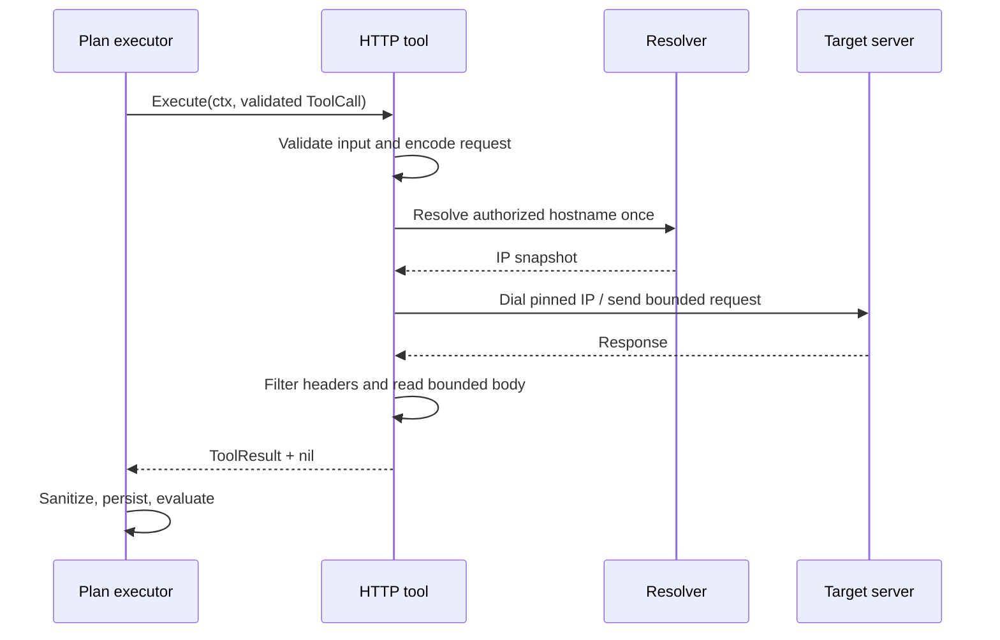

# Herramienta HTTP controlada — Design

## Resumen de la solución

La feature añade un adapter `http.request` que implementa el puerto
`harness.Tool`. Un constructor recibe un `specification.Target`, una
configuración confiable con permisos y límites explícitos, y fronteras
sustituibles para reloj, DNS y transporte. El constructor valida y congela ese
ámbito. El input del plan solo aporta método, path, query, headers no sensibles
y body JSON; nunca aporta una URL absoluta ni cambia los permisos.

Cada ejecución valida y codifica completamente el request antes de red,
resuelve una vez el hostname autorizado, fija las IPs para esa operación y usa
un transporte sin proxy ambiental. Cada redirect pasa por la misma validación
de esquema, autoridad, path, IP, método y presupuesto de hops. La respuesta se
lee hasta un límite, se filtran headers y se traduce a un mapa estructurado. El
adapter devuelve el resultado al executor y no conoce stores, journal,
assertions ni estado del run.

## Fuentes de contexto consultadas

| Fuente | Evidencia utilizada |
|---|---|
| `AGENTS.md` | Alcance del producto, una feature por sesión y puerta SDD. |
| `feature_list.json`, feature `id=5` | Input HTTP estructurado, target autorizado, destinos y redirects, timeout/cancelación, output limitado, secretos, ausencia de persistencia y tests locales. |
| `.codex/agents/spec.md` y `docs/specs.md` | Forma de los artefactos, EARS, bloqueo, aprobación y trazabilidad. |
| `docs/architecture.md` | Tool registry, orden de controles, límites explícitos, adapters sin propiedad del run, cancelación, retries seguros, target fuera del prompt, redirects revalidados y red no autorizada bloqueada. |
| `docs/conventions.md` | Interfaces consumidoras, errores tipados, contexto, tiempo inyectable, comentarios, tests herméticos y ausencia de secretos. |
| `specs/validation-specification/*` e `internal/specification/*` | `Target{ID, BaseURL}` y contrato v1: URL HTTP(S) absoluta sin userinfo, query ni fragment. |
| `specs/agent-harness/*`, `internal/harness/*` e `internal/tools/*` | `Tool`, `ToolCall`, `ToolResult`, `ToolSpec`, registry, clasificación transitoria/permanente y metadatos de efectos/idempotencia. |
| `specs/multi-step-validation-plan/*` e `internal/planning/*` | Validación de inputs antes de policy, ejecución secuencial, ownership del executor, retries y persistencia posterior al retorno de la herramienta. |
| `specs/assertion-engine/*` e `internal/assertion/*` | Outputs JSON compatibles consumidos por paths y resultados calculados sin modelo. |
| `internal/evidence/*` | Evidencia y sanitizer actuales; el adapter debe eliminar secretos de headers anidados antes de cruzar su frontera porque el sanitizer top-level no los alcanza. |

No se consultaron APIs, documentación ni repositorios externos. El contrato HTTP
observable queda definido enteramente por esta spec y por la biblioteca estándar
de Go como detalle reemplazable, no como tipo de dominio.

## Reglas arquitectónicas aplicadas

- El modelo propone datos; target, config, registry, policy y executor conservan
  autoridad.
- La validación estructural ocurre antes de DNS y conexión.
- La herramienta devuelve una observación; el executor conserva propiedad de
  budget, retry, evidencia, journal y resultados.
- Contexto y timeout cruzan toda frontera bloqueable y no se almacenan.
- No hay proxy implícito ni lectura de entorno.
- Los errores conservan causa y exponen categorías estables.
- La suite usa solo infraestructura local controlada.

No se propone ninguna excepción a arquitectura o convenciones.

## Convención de documentación del código

Toda entidad y toda función nueva o modificada, exportada o interna, incluirá
un comentario breve que explique su responsabilidad dentro de FeatureProof y
su relación con el flujo o frontera correspondiente. El comentario expresará
intención, invariantes o motivo arquitectónico, sin repetir nombre, parámetros
o sintaxis. La convención se aplica también a errores, configuración, fakes,
resolución de destinos, filtros de headers y auxiliares de límites.

## Áreas y paquetes afectados

| Paquete | Responsabilidad |
|---|---|
| `internal/tools/http` (package `httptool`) | Configuración, validación de input, construcción segura de request, resolución/dial, redirects, ejecución y traducción a output. |
| `internal/tools` | Solo la integración mínima que construya un `harness.ToolSpec` registrable, si resulta necesaria. |
| `internal/harness` | Reutilización de contratos existentes; solo se cambiará si hace falta preservar una categoría ya soportada sin romper consumidores. |
| `internal/specification` | Reutilización read-only de `Target`; no se amplía el formato YAML. |

No se necesitan cambios en `cmd/`, evidence store, planning, assertion engine ni
modelo de specification para entregar esta feature.

## Componentes y responsabilidades

### Config y constructor

`Config` contiene el target y valores explícitos: `AllowedMethods`,
`AllowedRequestHeaders`, `AllowedResponseHeaders`,
`FollowRedirectsForMethods`, `MaxRedirects`, `Timeout`, `MaxURLBytes`,
`MaxRequestHeaderBytes`, `MaxRequestBodyBytes`, `MaxResponseHeaderBytes` y
`MaxResponseBodyBytes`. También recibe reloj, resolver y una fábrica de
transporte/dial controlada por el paquete para tests.

El constructor:

1. valida `Target.BaseURL` y permite solo HTTP/HTTPS;
2. normaliza esquema, hostname, puerto efectivo y path base;
3. valida que todas las allowlists sean explícitas y coherentes; la de métodos
   contiene al menos uno, mientras headers y métodos de redirect pueden
   declararse vacíos para no conceder esas capacidades;
4. rechaza headers sensibles y hop-by-hop en la allowlist de request;
5. exige timeout y límites positivos, y redirects no negativos;
6. copia maps/slices para que el caller no pueda mutar el ámbito después;
7. produce una herramienta y un `ToolSpec` llamado `http.request` con
   `Effects=true`, `Idempotent=false` y validador de input asociado.

No hay defaults silenciosos. `MaxRedirects=0` es una elección explícita válida;
la lista de métodos que siguen redirects puede estar vacía si no se desean.

### Input validator

Traduce `map[string]any` a un request interno inmutable. Valida tipos exactos,
JSON finito, tokens HTTP, CR/LF, allowlists, path relativo y tamaños que pueden
conocerse antes de red. Codifica query y body una vez. Los errores contienen
categoría y field path y pueden distinguirse mediante `errors.Is/As`.

### Target scope y URL builder

`TargetScope` conserva el esquema, hostname ASCII normalizado, puerto efectivo
y segmentos del path base. El builder añade los segmentos del input al path
base y asigna la query ya codificada. Nunca usa `ResolveReference` con una URL
controlada por el input. La comprobación de pertenencia trabaja con segmentos
decodificados y evita comparaciones de prefijo textual (`/api` no contiene
`/apix`).

### Resolver y dialer fijado

Una interfaz mínima consumidora resuelve IPs con contexto. Cada `Execute`
resuelve el hostname una vez antes de crear el transporte de la operación. El
dialer acepta exclusivamente el hostname y puerto del scope, selecciona solo
IPs del snapshot y delega el socket a una función cancelable. Se desactiva
`Proxy` explícitamente y no se utiliza `http.DefaultTransport` mutable.

Las clases privada, loopback y link-local no se deniegan por defecto: un target
local puede ser la aplicación desplegada autorizada y los acceptance tests usan
servidores locales. El límite de confianza es el target fijado por el run. El
snapshot DNS, la autoridad exacta, el puerto exacto y la revalidación de
redirects impiden que el input cambie ese límite o que una segunda resolución
durante el mismo request lo desvíe.

### Redirect validator

El hook de redirects recibe cada request resultante y la cadena previa. Si el
método previo no está habilitado para seguimiento, el adapter detiene el
seguimiento y devuelve la respuesta 3xx sin error. Si sí está habilitado,
rechaza antes de dial:

- hops por encima de `MaxRedirects`;
- esquema, hostname o puerto distintos;
- userinfo o fragment;
- path fuera del path base;
- método resultante fuera de `AllowedMethods`;
- destino que no pueda usar el snapshot IP fijado;
- headers que no cumplan la política.

El body de un redirect solo puede reenviarse conforme al comportamiento del
cliente HTTP y siempre permanece sometido al mismo método permitido, timeout y
límites. No se implementa retry adicional.

### Executor HTTP y decoder

`Execute(ctx, ToolCall)` vuelve a aplicar el validator para que la herramienta
sea segura incluso si se usa fuera del registry. Crea un contexto hijo con el
timeout configurado; si vence con el padre activo lo traduce a `timeout`, y si
el padre está cancelado devuelve su causa.

El reader conserva como máximo `MaxResponseBodyBytes` y usa un byte adicional
solo para detectar truncación. Cierra siempre el body. El decoder produce:

```text
{
  status: number | null,
  headers: object<string, array<string>>,
  body: JSON value | string | null,
  body_format: "json" | "text" | "base64" | "empty",
  body_bytes: number,
  body_truncated: boolean,
  duration_ms: number,
  error: null | { category: string }
}
```

Un body completo con media type JSON se decodifica como JSON compatible. Texto
UTF-8 se conserva como string y bytes no UTF-8 como base64. Un body truncado no
se anuncia como JSON completo. `body_bytes` representa bytes capturados, no un
tamaño total desconocido; la feature 6 podrá añadir metadatos de tamaño y una
redacción más amplia.

Solo se copian response headers de la allowlist, con nombres canónicos y valores
en el orden observado. Los cuatro sensibles se omiten siempre, aunque una configuración
errónea intentara permitirlos. Los errores no incluyen URL completa, headers,
body ni dumps del cliente.

### Errores

`ConfigError`, `InputError` y `OperationError` contienen categorías estables y
field path cuando aplica. El error operativo envuelve la causa para diagnóstico
y se adapta al `harness.OperationError` existente:

- `timeout`, fallos DNS temporales, connect/read temporales: `transient`;
- destino/redirect denegado, TLS no recuperable, encode y límites:
  `permanent`.

El output expone solo `{category}`. Para una respuesta HTTP válida,
`ErrorClass` queda vacío aunque el status sea 4xx/5xx. La cancelación del padre
retorna su error directamente para que el executor aplique su contrato actual y
no fabrique evidencia después de cancelar.

## Contratos externos observados

No se expone `net/http.Request`, `http.Client`, `url.URL`, `net.IP` ni errores de
la biblioteca estándar fuera del adapter. Los conceptos externos se traducen a
`map[string]any`, errores propios y `harness.ToolResult`.

El comportamiento HTTP usado es deliberadamente estrecho: no proxy ambiental,
no cookies persistentes, no jar, no auth automática, no URL aportada por el
input y no retries del transporte. HTTPS mantiene hostname para SNI y
verificación del certificado. Cualquier transporte de test debe cumplir el
mismo contrato de destino o permanecer detrás de una interfaz solo accesible al
paquete.

## Flujo principal



## Flujos de error

1. **Config inválida:** el constructor falla; la capacidad no se registra.
2. **Input inválido o request demasiado grande:** falla antes de DNS.
3. **DNS sin resultado/fallo:** devuelve error estructurado; no intenta otro
   hostname ni consulta el entorno.
4. **Dial fuera del scope:** `destination_denied` antes de socket.
5. **Redirect fuera del scope o límite:** no abre el siguiente destino y
   devuelve error estructurado.
6. **Timeout propio:** cierra/cancela I/O, devuelve `timeout` transitorio.
7. **Cancelación padre:** devuelve la causa del contexto y detiene el trabajo.
8. **Headers de response excesivos:** transporte aborta sin exponerlos.
9. **Body excesivo:** retorna el prefijo acotado con truncación explícita.
10. **4xx/5xx:** retorna una respuesta normal para assertions.

## Propiedad del estado y concurrencia

La herramienta construida conserva solo configuración inmutable y dependencias
concurrent-safe. Cada `Execute` posee request, contexto hijo, snapshot DNS,
cliente/transporte y buffers. No almacena contexto ni resultados. Esto permite
llamadas concurrentes futuras sin compartir estado mutable, aunque el executor
actual sea secuencial.

No se crean goroutines de aplicación. Las que utilice la biblioteca HTTP quedan
acotadas por contexto, cierre del response body y cierre de conexiones idle al
terminar la operación.

## Cancelación

El contexto padre se propaga a resolver, dial, request y lectura. El timeout
propio usa un contexto hijo y siempre cancela su timer al retornar. Antes de
cada fase se comprueba el padre. Si el padre termina, su causa prevalece sobre
clasificaciones operativas. El test bloqueable coordina con canales y waits,
nunca con `time.Sleep`.

## Retries e idempotencia

El adapter hace exactamente un intento de operación por llamada a `Execute`.
Los redirects autorizados son hops del mismo intercambio y están limitados; no
se consideran retries. El `ToolSpec` es conservador (`Effects=true`,
`Idempotent=false`) porque el método es dato de input y la metadata actual no es
dinámica. Así el executor no reintenta por asumir que GET es seguro ni extiende
esa presunción a otros métodos. Una futura capacidad específica por método o
una clave de idempotencia de origen confiable podrá ampliar el contrato mediante
otra spec.

## Observabilidad y datos sensibles

La herramienta no escribe logs, eventos ni evidencias. Retorna categorías e
información acotada para que el executor registre mediante su flujo existente.
Nunca retorna el valor real de los cuatro headers sensibles. La URL completa no
aparece en errores porque la query podría contener datos; se usa categoría y
field path. La futura feature de redacción aplicará reglas adicionales a body,
query y headers configurados.

## Estrategia de pruebas

Los tests unitarios ejercitan constructor, input, path, límites, filtrado,
errores y metadata sin sockets. Los tests de integración usan `httptest.Server`
o `httptest.NewTLSServer`, targets con puerto efímero explícito, resolver/dialer
controlados y canales para timeout/cancelación. Ningún test consulta DNS público
ni variables de entorno.

| Requirement | Componente | Prueba prevista |
|---|---|---|
| R1 | input validator | `TestValidateInputAcceptsStructuredRequest`; `TestValidateInputRejectsMalformedFieldsBeforeNetwork` |
| R2 | target scope / URL builder | `TestRequestURLStaysBelowTargetBasePath`; `TestInputCannotProvideAbsoluteOrEscapingURL` |
| R3 | resolver / pinned dialer | `TestExecuteDialsOnlyPinnedAuthorizedDestination`; `TestExecuteIgnoresEnvironmentProxy`; `TestExplicitLocalTargetIsAllowed` |
| R4 | redirect validator | `TestRedirectIsRevalidatedAtEveryHop`; `TestRedirectCannotEscapeAuthorizedTarget`; `TestRedirectLimitAndMethodPolicy` |
| R5 | executor | `TestExecuteDistinguishesToolTimeoutFromCallerCancellation`; `TestExecuteClosesBlockedOperation` |
| R6 | bounds | `TestRequestLimitsFailBeforeNetwork`; `TestResponseHeadersAndBodyAreBounded` |
| R7 | decoder / error mapper | `TestExecuteReturnsStructuredHTTPResponse`; `TestHTTPErrorStatusRemainsObservable`; `TestOperationalFailureIsStructured` |
| R8 | header policy | `TestSensitiveRequestHeadersAreRejected`; `TestOutputContainsOnlyAllowedNonSensitiveHeaders`; `TestSecretsNeverAppearInResultsOrErrors` |
| R9 | adapter integration | `TestHTTPToolReturnsWithoutMutatingExecutorState`; integración con fake store/journal del executor |
| R10 | ToolSpec / executor boundary | `TestHTTPSpecDeclaresConservativeEffects`; `TestHTTPToolDoesNotRetry` |
| R11 | constructor / suite | `TestNewRejectsIncompleteConfiguration`; `TestHTTPToolSuiteUsesOnlyControlledLocalServers` |

Además se ejecutarán `go test ./...`, `go test -race ./...`, `go vet ./...` y la
comprobación de cobertura exigida por `docs/verification.md`.

## Alternativas y decisiones

- **URL absoluta en el input:** descartada porque convertiría al modelo en
  autoridad de red.
- **Confiar en `http.DefaultClient`:** descartado por proxy ambiental,
  redirects y estado global no controlados.
- **Bloquear todas las IP privadas:** descartado porque el target autorizado
  puede ser un despliegue aislado y los tests deben usar loopback. Se fija la
  autoridad y la resolución por operación.
- **Resolver en cada redirect:** descartado porque permitiría DNS rebinding
  dentro de una operación.
- **Usar prefijo textual para el path base:** descartado porque `/api` y
  `/apix` no comparten ámbito por segmentos.
- **Exponer todos los headers y confiar solo en el sanitizer:** descartado
  porque el sanitizer actual no cubre valores anidados y esta feature exige que
  cuatro secretos nunca crucen la frontera.
- **Marcar GET/HEAD como idempotentes dinámicamente:** aplazado porque
  `ToolSpec` tiene metadata estática y el input puede seleccionar método. La
  clasificación conservadora evita retries accidentales.
- **Leer el body completo para conocer su tamaño:** descartado porque viola el
  límite de memoria; se captura un prefijo y truncación.
- **Defaults de producto:** descartados. Los acceptance criteria no fijan
  valores; el caller debe suministrar permisos y límites explícitos.

## Mapa inicial de trazabilidad

| Requirement | Tasks | Resultado verificable |
|---|---|---|
| R1 | T1, T2, T7 | Input exacto y errores con path antes de red. |
| R2 | T1, T3, T7 | URL siempre derivada del target y dentro del path base. |
| R3 | T1, T3, T4, T7 | Resolución fijada y dial solo a autoridad/IP autorizadas, sin proxy. |
| R4 | T3, T4, T7 | Cada redirect se revalida y queda limitado. |
| R5 | T4, T7 | Timeout propio y cancelación padre se distinguen y liberan recursos. |
| R6 | T1, T2, T4, T5, T7 | Request y response respetan todos los límites explícitos. |
| R7 | T1, T5, T7 | Respuesta y fallos producen output estable y acotado. |
| R8 | T1, T2, T5, T7 | Allowlist y omisión obligatoria impiden exponer secretos. |
| R9 | T6, T7 | Adapter retorna datos sin stores ni mutación de run. |
| R10 | T1, T4, T6, T7 | Metadata conservadora y cero retries internos. |
| R11 | T1, T7 | Config explícita y suite local hermética. |
