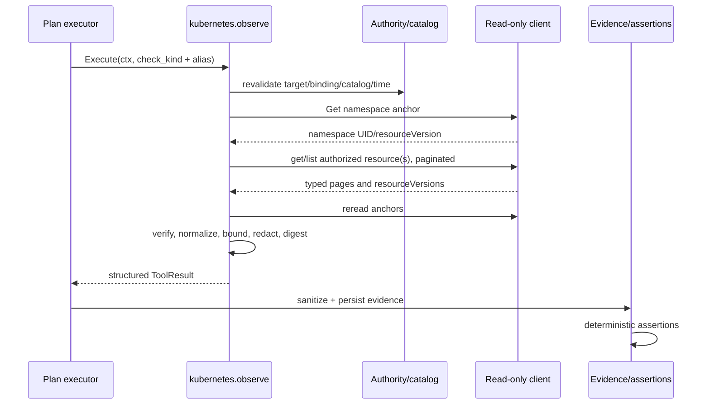

# Herramienta de validación operativa de Kubernetes — Design

## Resumen de la solución

Se añadirá `internal/tools/kubernetes`, un adapter `harness.Tool` construido para
un único target Kubernetes vigente. Composición le entrega target y binding,
un catálogo de inspección sellado, límites explícitos, reloj y un puerto de
lectura Kubernetes. El constructor deriva y congela la autoridad: namespace,
UID, recursos, owners, selectors y relaciones. El input del plan solo puede
seleccionar un check y un alias lógico.

La tool realiza lecturas `get/list` acotadas, traduce objetos del SDK a modelos
propios, elimina texto y campos no allowlisted, registra versiones y detecta
drift mediante anchors inicial/final. Retorna un documento JSON-compatible; el
executor conserva retry, sanitizer, store, journal y evaluación. Las assertions
existentes calculan resultados funcionales y el modelo no declara verdicts.

## Fuentes de contexto consultadas

| Fuente | Evidencia utilizada |
|---|---|
| `AGENTS.md`, `.codex/agents/spec.md`, `docs/specs.md` | Feature única, SDD, EARS, outputs permitidos y puerta humana. |
| `feature_list.json`, feature 33 | Recursos, aislamiento, RBAC, límites, assertions y fake API exigidos. |
| `docs/architecture.md` | ARCH-001..012: tool registrada, policy, evidencia antes de estado, cancelación, redacción y ausencia de mutación del run. |
| `docs/conventions.md`, `docs/verification.md` | Interfaces consumidoras, errores tipados, contexto, tests herméticos, cobertura y comentarios sistémicos. |
| `specs/kubernetes-environment/*` | Target gestionado, namespace por run, UID en reservation, atestación, resourceVersions y separación de fallos operativos. |
| `internal/environment/{model,service}.go` | `ValidationTarget`, `Binding`, `VerifyTarget`, `VerifyBinding` y autoridad provider-neutral. |
| `internal/environment/kubernetes/*` | Catálogo/cliente cerrado de feature 32, modelos Deployment/Pod/Service/EndpointSlice y taxonomía segura de errores. |
| `specs/agent-harness/*`, `internal/harness/*`, `internal/tools/*` | `Tool`, `ToolSpec`, registry, ToolResult y clasificación retryable. |
| `specs/http-tool/*`, `internal/tools/http/*` | Patrón de adapter sin estado, validación defensiva, output estructurado y metadata de efectos. |
| `specs/multi-step-validation-plan/*`, `internal/planning/*` | Inputs estructurados, executor como owner de retries/evidencia y estados de step. |
| `specs/assertion-engine/*`, `internal/assertion/*` | Assertions por paths, estados ternarios y verdict fuera del modelo. |
| `specs/evidence-redaction/*`, `internal/evidence/*` | Sanitizer recursivo, truncation metadata y proyección de modelo monotónica. |

No se requiere consultar servicios externos para definir el contrato de producto.
El adapter productivo usará el mismo `client-go` ya fijado por la feature 32 y
traducirá sus tipos; ningún tipo del SDK cruzará la frontera de la tool.

## Reglas arquitectónicas aplicadas

- ARCH-001/002/011: el modelo selecciona una capacidad registrada; catálogo,
  target, policy y tool determinan autoridad.
- ARCH-003/004: la tool observa; evidencia y assertions deterministas producen
  estados y verdicts.
- ARCH-005/006: timeout, páginas, items y bytes son finitos y todo I/O propaga
  contexto.
- ARCH-007/008/009: Events y metadata Kubernetes son datos no confiables,
  proyectados y redactados antes de journal/modelo.
- ARCH-010: la suite usa fake API y dependencias controladas.
- ARCH-012: la tool no conoce ni muta el run.
- CONV-002/003: paquete cohesionado y puertos estrechos definidos por el
  consumidor.

No se propone ninguna excepción.

## Convención de documentación del código

Toda entidad, constante, variable, función, método y helper de test nuevo o
modificado incluirá un comentario breve que explique su responsabilidad dentro
del sistema, su frontera o el invariante que protege. Esto incluye símbolos no
exportados, variables de paquete, errores centinela, factories, fakes y helpers
de assertions. El comentario no se limitará a repetir el nombre o la sintaxis.

## Paquetes afectados

| Paquete | Responsabilidad |
|---|---|
| `internal/tools/kubernetes` | Catálogo sellado, config, input, modelo normalizado, snapshot reader, checks, errores y adapter productivo. |
| `internal/tools` | Registro de la ToolSpec solo si composición actual lo requiere; no añade autoridad dinámica. |
| `internal/environment` | Reutilización read-only de target/binding; no cambia lifecycle. |
| `internal/environment/kubernetes` | Reutilización de cliente/configuración de cluster; una ampliación deberá ser solo el puerto de lectura necesario, sin mezclar provisioning. |
| `internal/planning`, `internal/assertion`, `internal/evidence` | Reutilización del flujo existente; cambios mínimos solo si hace falta mapear outcomes operativos sin perder semántica. |

No se modifica provisioning, cleanup, control plane, project config ni tenant
security.

## Contratos propuestos

### Identidad de herramienta e input

Nombre estable: `kubernetes.observe`. La `ToolSpec` declara `Effects=false` e
`Idempotent=true`. Su input tiene shape exacta:

```text
{ check_kind: string, resource_alias: string }
```

Para `declared_connectivity`, `resource_alias` designa un relationship alias.
No existen opciones, selectors, names, namespaces, limits o continuation tokens
en el input. El validator rechaza claves extra y `Execute` valida de nuevo para
mantener seguridad fuera del registry.

### InspectionCatalog

El catálogo v1 es composition-owned, canónico e inmutable. Cada entrada liga:

- digest del target/selection/template/profile y provider version;
- namespace lógico y UID esperados;
- aliases de Deployment, Pod set, Job, Service, Event scope y NetworkPolicy;
- nombre Kubernetes interno, UID/owner esperado y selector precompilado donde
  sea necesario;
- checks admitidos por alias;
- relaciones de conectividad: source alias, destination Service alias,
  protocol, port y policy alias.

El catálogo no se expone al modelo. Su sello cubre orden canónico y todos los
campos de autoridad. Un Job puede existir aunque el provider de feature 32 no lo
cree: debe estar preautorizado por composición y pertenecer al mismo namespace;
esta feature solo lo observa.

### Config y límites

`Config` incluye target, binding, catálogo, `Timeout`, `MaxPages`,
`PageSize`, `MaxItems`, `MaxEvents`, `MaxOutputBytes`, reason allowlist, reloj,
fábrica de timeout y `Reader`. Todos los límites son positivos y coherentes;
no hay defaults. El constructor verifica/copia todo y falla antes de registro.

### Reader port

El paquete consumidor define un puerto sin operaciones genéricas:

```text
GetNamespace
GetDeployment
ListOwnedPodsPage
GetJob
GetService
ListServiceEndpointSlicesPage
ListScopedEventsPage
GetNetworkPolicy
```

Cada método recibe namespace/identidad ya derivados y `PageRequest` interno con
limit/token/resourceVersion. No acepta GVR, query o selector textual de input.
El adapter `client-go` construye selectors exclusivamente desde valores
precompilados del catálogo. No implementa Secrets ni verbos de escritura.

### Modelo normalizado

Todos los checks retornan el mismo envelope:

```text
{
  schema: "featureproof.kubernetes-observation/v1",
  check_kind: string,
  resource_alias: string,
  outcome: {
    category: string,
    complete: boolean,
    drift: boolean,
    truncated: boolean
  },
  observation: object | null,
  versions: [{ resource_alias, kind, uid_digest, resource_version }],
  snapshot_digest: string | null,
  truncations: [{ section, observed, retained }],
  error: null | { category: string }
}
```

Los aliases son IDs composition-owned; nombres/namespace/IPs no salen. UIDs se
usan para autoridad y solo se exponen como digest si hacen falta para auditoría.
`resourceVersion` sí se conserva cuando existe porque es requisito de snapshot,
pero se trata como string opaca. `observation` cambia por check:

- Deployment: generations, desired/updated/available/ready counters y condition
  flags/reasons allowlisted.
- Pods: lista ordenada de aliases efímeros derivados por digest, phase,
  readiness, terminating y restart count por container role allowlisted.
- Job: generation, completions, active/succeeded/failed y conditions/reasons
  allowlisted.
- Service/endpoints: service type/ports declarados y counts ready/not-ready por
  EndpointSlice; nunca addresses o Pod names.
- Events: involved resource alias, type, normalized reason, count y timestamps;
  nunca message/note/reporting identity.
- Connectivity: source/destination aliases, protocol, port, `declared`,
  `policy_present` y endpoint counts; no afirma reachability real.

## Componentes y responsabilidades

### Catalog sealer y authority builder

Valida target/binding mediante `environment.VerifyTarget/VerifyBinding`, exige
`ProviderID=kubernetes`, target vigente y ReservationID no vacío. Verifica el
catálogo contra digests/IDs y crea un `Authority` privado desconectado del
caller. Antes de cada Execute vuelve a validar tiempo y relaciones selladas; el
namespace inicial confirma nombre y UID antes de otra lectura.

### Input validator

Valida shape exacta, tipos, IDs acotados, compatibilidad check/alias y ausencia
de claves extra. Los errores tipados incluyen categoría y field path, no valores.
No cruza I/O.

### SnapshotReader

Orquesta una comprobación con un contexto hijo. Lee el namespace como anchor
inicial; llama al método estrecho del check; sigue paginación bajo budgets;
normaliza; relee namespace y, para checks compuestos, el recurso anchor. Compara
UIDs, owners, resourceVersions y membresía.

Kubernetes no ofrece un snapshot transaccional entre kinds. Por ello el reader
no promete serialización global: registra todas las versiones y falla cerrado
si el doble read demuestra cambio. Los resourceVersions nunca se comparan
numéricamente.

### Check evaluators

Cada evaluator traduce modelos externos a una proyección allowlisted y valida
invariantes propias. No evalúa thresholds del plan ni construye assertions. Un
estado operacional observado, como `available_replicas=0`, sigue siendo
`outcome.category=observed`; solo una assertion declarada decide si incumple.

### Limiter y normalizer

Paginación usa `PageSize`, guarda tokens solo en memoria durante la llamada y
detecta ciclos. `MaxPages`, `MaxItems`, `MaxEvents` y `MaxOutputBytes` aplican
antes del retorno. Si se pierde exhaustividad, se conserva únicamente una
proyección segura marcada `complete=false`, `truncated=true` y la categoría
`insufficient_evidence`; nunca se presenta el prefijo como conjunto completo.

El encoder canónico ordena objects, aliases, versions, conditions y Events antes
de calcular `snapshot_digest`. No incluye timestamps locales o durations en el
digest del contenido observado.

### Error mapper

Traduce errores externos a categorías propias content-free:

| Fuente | Outcome / retry |
|---|---|
| recurso exacto NotFound | `resource_absent`, permanente |
| namespace NotFound o UID cambiado | `integrity_error`, permanente |
| Forbidden | `access_denied`, permanente |
| timeout hijo | `timeout`, transitorio solo para el executor y siempre inconclusive |
| cancelación padre | retorna causa, sin evidencia parcial |
| 429/5xx/transporte temporal | `transient_error`, transitorio |
| schema/owner/count inválido | `integrity_error`, permanente |
| drift/lista truncada | `insufficient_evidence`, permanente para ese intento |

Los bodies y mensajes Kubernetes no aparecen en error ni output.

### Adapter client-go y RBAC

El adapter recibe un cliente autenticado explícitamente desde composición; no
lee kubeconfig/env dentro de la tool. Usa APIs tipadas `apps/v1`, `batch/v1`,
`core/v1`, `discovery.k8s.io/v1`, `networking.k8s.io/v1` y Events soportados,
traducidos inmediatamente a structs propios.

El Role esperado es namespaced y concede solo `get,list` a esos recursos. No se
usa `watch`; el doble read acotado sustituye streams abiertos. No hay wildcard,
Secrets, ConfigMaps, Nodes, RBAC read, logs ni subrecursos interactivos. La
service account de la tool es distinta de la service account del workload.

La tool no puede demostrar por sí sola que el cluster nunca amplió permisos;
composición valida la forma del role/binding que despliega y los tests de puerto
demuestran que el binario carece de operaciones adicionales. Forbidden siempre
falla cerrado.

### Evidence y assertion bridge

La tool devuelve un `harness.ToolResult`. El `PlanExecutor` sanea input/output,
persiste evidencia terminal y entrega el output confirmado al assertion engine.
Los paths recomendados son `/outcome/category`, `/outcome/complete`,
`/outcome/drift` y campos concretos bajo `/observation`.

Para resultados `observed`, las assertions actuales pueden comparar contadores,
booleans y strings. Outcomes operativos deben convertirse en step inconclusive
con causa tipada antes de evaluar condiciones que asumirían evidencia completa.
`resource_absent` permanece un dato explícito: solo una assertion declarada
sobre su categoría puede confirmar incumplimiento. Ningún texto del modelo
escribe `AssertionResult` o `PlanResult`.

## Flujo principal



## Flujos por check

1. **Deployment:** get exact catalogued name; verify namespace, UID/owner and
   catalog relation; project counters/conditions; reread anchor.
2. **Pods:** list with catalogued selector; page; retain only exact owner; reject
   ambiguous ownership; project restart/readiness; reread Deployment.
3. **Job:** get exact catalogued name; verify UID/owner; project counters and
   terminal conditions; reread Job.
4. **Service endpoints:** get Service; page EndpointSlices selected by exact
   service relation; verify owners/ports; aggregate counts; reread Service.
5. **Events:** page by involved UIDs from the catalog; defensively filter every
   item; project only allowlisted reason/type/count/time; verify namespace.
6. **Declared connectivity:** resolve catalog relationship; get destination
   Service, EndpointSlices and exact NetworkPolicy; compare only declared
   protocol/port/relation; reread anchors.

## Flujos de error

1. Input/config/authority inválida falla antes del API.
2. Namespace ausente/recreado/expirado produce integrity error y detiene.
3. Recurso exacto ausente produce envelope `resource_absent` completo.
4. Forbidden produce envelope/error `access_denied`, sin fallback.
5. Token inválido/cíclico o budget agotado produce insufficient evidence con
   truncación; no sigue páginas.
6. Cambio concurrente produce drift; reemplazo de UID produce integrity error.
7. Timeout cancela el cliente; cancelación padre prevalece y no publica parcial.
8. Error transitorio usa `harness.OperationError` para que solo el executor
   decida retries.
9. Fallo de redacción/persistencia impide assertions y contexto conforme al flujo
   existente.

## Propiedad del estado e inmutabilidad

La instancia de Tool posee solo config/authority/copias inmutables y un cliente
concurrent-safe. Cada Execute posee contexto hijo, tokens, sets de deduplicación,
buffers, versions y digest. No almacena resultados, contexto, evidence IDs,
estado de run ni continuation tokens.

Los catálogos y outputs se copian en frontera. El cliente externo nunca puede
mutar el target o catálogo después del constructor. Los mapas se recorren y
serializan en orden canónico.

## Concurrencia y cancelación

Las llamadas concurrentes comparten solo valores inmutables y el cliente
concurrent-safe. No hay locks alrededor de I/O ni goroutines propias. Todas las
llamadas reciben el contexto hijo. Antes de una página, una reread y la
normalización final se comprueba `ctx.Err()`.

Los tests de bloqueo coordinan mediante canales; no usan `time.Sleep`. Si
client-go crea trabajo interno, la tool siempre cancela el contexto y no retiene
watches ni response bodies.

## Retries e idempotencia

La tool no reintenta internamente. Un read es side-effect free, por lo que la
ToolSpec es idempotente y el executor puede repetir solo fallos transitorios
dentro de su budget. Cada retry empieza desde namespace anchor nuevo, sin token
o resultado anterior, y genera evidencia/versiones propias. Forbidden,
NotFound, drift, truncación, input e integrity no son transient retries.

## Observabilidad y datos sensibles

La tool no escribe logs ni journal. Retorna categorías, aliases, counts,
resourceVersions y digests seguros. No retorna namespace/names/addresses,
selectors, labels, annotations, Event messages, remote status bodies, secrets o
credenciales. La composición puede medir duración y contar páginas/resultados
sin payload. El executor aplica sanitizer antes de store/modelo.

Canarios se insertan en cada campo omitido durante tests y se buscan
byte-for-byte en outputs, errores, eventos, evidence files y model projection.

## Estrategia de pruebas

Los unit tests usan un `Reader` fake scriptable para constructor, input,
normalización, errores, límites y drift. Los tests de integración del adapter
usan el fake client/API server de Kubernetes con reactors para paginación,
Forbidden, cancelación y cambios concurrentes. No usan cluster, red, kubeconfig,
DNS, credenciales ni reloj real.

| Requirement | Componente | Pruebas previstas |
|---|---|---|
| R1 | authority builder | `TestNewBindsVerifiedKubernetesTargetAndNamespaceUID`; `TestAuthorityMismatchFailsBeforeAPI` |
| R2 | catalog/input | `TestValidateAcceptsOnlyAuthorizedCheckAlias`; `TestValidateRejectsNamesNamespacesSelectorsQueriesAndUnknownFields` |
| R3 | deployment check | `TestDeploymentObservationNormalizesAvailabilityAndVersion`; `TestDeploymentAbsenceAndDriftRemainDistinct` |
| R4 | pod check | `TestPodObservationFiltersOwnerAndOrdersRestarts`; `TestPodPartialOrEmptySetDoesNotImplySuccess` |
| R5 | job check | `TestJobObservationNormalizesActiveCompleteAndFailed`; `TestJobRejectsOwnerDriftAndOmitsMessages` |
| R6 | service check | `TestServiceEndpointObservationAggregatesOnlyOwnedSlices`; `TestEndpointPaginationAndAbsenceAreExplicit` |
| R7 | event check | `TestEventsAreScopedAllowlistedOrderedAndBounded`; `TestEventMessagesAndUnknownReasonsNeverCrossBoundary` |
| R8 | connectivity check | `TestDeclaredConnectivityUsesOnlyCatalogRelationPolicyAndEndpoints`; `TestConnectivityNeverPerformsActiveProbe` |
| R9 | adapter/RBAC | `TestAdapterUsesOnlyGetAndListOnAllowlistedResources`; `TestForbiddenIsAccessDeniedAndSecretsAreNeverRequested` |
| R10 | pager/limiter | `TestPaginationCompletesWithinBudgets`; `TestPaginationCycleAndLimitProduceTruncatedInsufficientEvidence` |
| R11 | snapshot | `TestSnapshotRecordsOpaqueVersionsAndCanonicalDigest`; `TestConcurrentResourceChangeProducesDrift` |
| R12 | execution | `TestCallerCancellationAndToolTimeoutStopFurtherReads`; `TestOnlyTransientFailuresAreRetryable` |
| R13 | normalizer/redaction | `TestNormalizationIsOrderIndependentAndBounded`; `TestCanariesNeverAppearInAnyArtifact` |
| R14 | planning integration | `TestObservedConditionUsesDeterministicAssertions`; `TestInsufficientAbsentAndAccessOutcomesMapWithoutModelVerdict` |
| R15 | registry/full suite | `TestSpecIsReadOnlyIdempotentAndRegisteredOnce`; `TestKubernetesToolSuiteIsHermeticAndCommentsCoverSymbols` |

También se ejecutarán `gofmt` check, `go vet ./...`, `go test ./...`,
`go test -race ./...`, repetición race del paquete afectado y coverage del código
nuevo/modificado >= 85 % sin redondear.

## Alternativas y decisiones

- **Tool genérica get/list:** descartada; permitiría al modelo ampliar scope.
- **Un ToolSpec por recurso:** descartado por ahora; una tool con enum cerrado y
  aliases conserva un contrato/limiter común sin perder validación exacta.
- **Namespace/nombre en input:** descartado; la autoridad viene del target y
  catálogo.
- **Reutilizar directamente `ClusterClient` de provisioning:** descartado como
  contrato público porque contiene mutaciones y Secrets. Puede reutilizar
  transporte/config, pero la tool consume un puerto read-only distinto.
- **Watch para snapshot:** descartado; amplía RBAC y ciclo de vida. Se usan reads
  finitos y anchors.
- **resourceVersion numérica o snapshot transaccional:** descartado; Kubernetes
  la trata como opaca y no garantiza transacción cross-kind.
- **Exponer IPs/nombres/event messages:** descartado por minimización y riesgo de
  secretos/instrucciones.
- **Probe activo de conectividad:** descartado; la aceptación pide conectividad
  declarada y una prueba activa correspondería a otra capacidad de red.
- **Truncar y declarar éxito:** descartado; una colección parcial no prueba una
  condición universal.
- **Que la tool marque failed:** descartado; assertions y evidence IDs son la
  única fuente de resultado funcional.
- **SelfSubjectAccessReview en cada call:** descartado; requiere permisos/API
  adicionales. Composición fija RBAC y Forbidden falla cerrado.

## Mapa inicial de trazabilidad

| Requirement | Tasks | Resultado verificable |
|---|---|---|
| R1 | T1, T2, T11 | Autoridad exacta y namespace UID se verifican antes de recursos. |
| R2 | T1, T3, T11 | Input solo selecciona check/alias autorizados. |
| R3 | T4, T11 | Deployment se proyecta con disponibilidad/versiones y drift. |
| R4 | T5, T11 | Pods propios y reinicios se observan sin parciales ambiguos. |
| R5 | T6, T11 | Jobs presentan estados tipados sin texto remoto. |
| R6 | T7, T11 | Service/EndpointSlices se agregan por ownership. |
| R7 | T8, T11 | Events quedan scopiados, acotados y sin messages. |
| R8 | T9, T11 | Relación declarada usa catálogo/policy, sin probe. |
| R9 | T2, T10, T11 | Puerto y adapter carecen de verbos/recursos prohibidos. |
| R10 | T3, T5, T7, T8, T11 | Paginación y budgets fallan cerrados. |
| R11 | T3, T4, T5, T7, T9, T11 | Versions/digest/drift se registran en checks compuestos. |
| R12 | T3, T10, T11 | Contexto detiene I/O y solo transient habilita retry externo. |
| R13 | T3, T4-T9, T11 | Proyecciones canónicas y canarios ausentes. |
| R14 | T10, T11 | Executor/evidence/assertions distinguen outcomes sin modelo. |
| R15 | T1, T10, T11 | Registry, comentarios, fake API y gates verifican entrega. |
