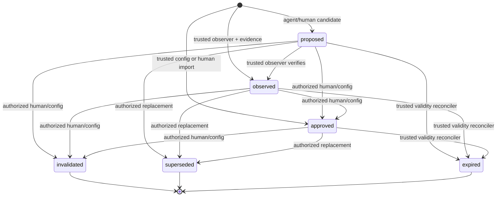

# Memoria de proyecto validada y versionada — Diseño

## Resumen de la solución

La feature añade un dominio `projectmemory` independiente del filesystem y un
servicio de aplicación que controla creación, transición, consulta y binding.
La fuente de verdad es un stream append-only por proyecto. Cada evento contiene
la versión canónica resultante, expected head, identidad idempotente, digest del
evento anterior y autenticación producida por una capacidad resuelta en
composición. Un snapshot autenticado acelera apertura y consulta, pero se valida
contra el journal antes de servir datos.

El modelo solo interactúa con DTOs acotados: puede emitir una propuesta v1 y
recibir una proyección segura de recuerdos ya elegibles. No recibe el store, una
clave, un path, evidencia completa ni una capacidad de transición. Planning y
functional flow pueden sellar un `MemoryBinding` explícito; la feature no decide
qué cabe en un prompt ni hace ranking semántico.

El diseño sigue `docs/architecture.md`: el agente propone y el sistema valida;
la memoria no reemplaza evidencia ni assertions; las dependencias externas se
ocultan detrás de puertos del consumidor; el core permanece determinista y
probable con fakes.

## Fuentes de contexto consultadas

| Fuente | Decisión extraída |
|---|---|
| `AGENTS.md`, `docs/specs.md` | Una feature SDD, approval humana previa, trazabilidad R→task→test. |
| `docs/architecture.md` | Autoridad fuera del modelo, datos externos no confiables, core determinista, stores mediante interfaces. |
| `docs/conventions.md` | Interfaces en consumidor, contexts propagados, errores tipados, reloj inyectado, sin goroutines ocultas. |
| `docs/verification.md` | Suite hermética, race, builds aplicables y coverage >=85% del diff. |
| Feature 24 `generated-contract-review` | Decisiones humanas durables, invalidación por drift, proyecciones seguras y publicación atómica. |
| Feature 25 `test-identities` | Material sensible permanece en composición y el dominio conserva referencias opacas. |
| Feature 26 `fixture-api` | Intent/CAS/recovery local, cleanup finito y protección multiplataforma del root. |
| Feature 27 `functional-flow-validation` | Ledger/evidencia inmutables, bindings de revisión y recuperación sin repetir efectos. |
| `internal/agentplanning`, `internal/functionalflow`, `internal/validationworkflow` | Contratos existentes de proposal, evidencia, artifacts y servicio compartido; la integración debe ser aditiva y opcional. |

No se consultan contratos externos. Los formatos persistidos y de superficie son
contratos propios de FeatureProof.

## Decisiones de contrato

### Taxonomía cerrada

Las clases v1 son deliberadamente pequeñas:

- `fact`: propiedad verificable de un proyecto o revisión;
- `decision`: elección humana/configurada con procedencia explícita;
- `convention`: regla de proyecto aprobada, tratada como datos hasta que otro
  componente autorizado decida usarla;
- `diagnostic`: observación útil para investigación, nunca prueba funcional por
  sí sola.

El contenido usa `subject + predicate + TypedValue`. Esto evita documentos
opacos y crea una clave lógica para detectar contradicciones. `TypedValue` es
una unión estricta; el JSON se canonicaliza y se limita en profundidad, nodos,
keys, strings y bytes. No admite templates, instrucciones ejecutables ni
referencias que se resuelvan implícitamente.

Confianza, autoridad y sensibilidad son dimensiones independientes. Un valor
`high` no aprueba; `restricted` no permite secretos; `approved` no convierte
texto externo en instrucción privilegiada.

### Máquina de estados



Una transición siempre crea una nueva `MemoryVersion` del mismo ID. Para
`superseded`, el reemplazo debe estar confirmado primero, ser del mismo proyecto
y clave lógica, y el evento antiguo guarda solo su ID/version/digest. No hay
reactivación ni transición desde terminal. Corregir contenido crea otro recuerdo;
no modifica una versión.

### Scopes y validez

`Scope` es una unión cerrada:

| Kind | Binding obligatorio | Elegibilidad |
|---|---|---|
| `run` | project, run ID, revision ID | coincidencia exacta de los tres |
| `revision` | project, repository ID, commit OID completo | coincidencia exacta |
| `project` | project, repository ID | coincidencia más política temporal/config/evidencia |

El servicio recibe `QueryAuthority` desde configuración, no desde el request.
Incluye reloj, revision/config digest actuales, estados/autoridades/clases
permitidos, sensibilidad máxima y política de staleness por clase. `valid_until`
es exclusivo. Un evento `expired` materializa el resultado determinista para
auditoría, pero una query excluye inmediatamente un record temporalmente inválido
aunque la reconciliación todavía no haya persistido el evento.

## Componentes y responsabilidades

### `internal/projectmemory`

- **Record validator/canonicalizer:** valida v1, deep-copy, normaliza instantes y
  JSON, calcula claves/digests y aplica límites.
- **Transition engine:** implementa la tabla de estados y comprueba authority,
  actor, evidence y replacement.
- **Secret gate:** inspecciona todos los strings, keys, paths y valores antes de
  producir un comando persistible. Recibe reglas/canarios confiables.
- **Eligibility evaluator:** aplica filtros exactos y devuelve candidato,
  exclusión tipada o contradicción; no hace ranking semántico.
- **Service:** caso de uso único para propose/observe/approve/invalidate/
  supersede/expire/query/get historical/bind/revalidate.
- **MemoryStore port:** frontera consumida por Service para streams, CAS,
  idempotencia, snapshots y lecturas históricas.
- **Evidence authority port:** verifica referencias/digests sin obtener bodies.
- **Principal authority port:** traduce un principal autenticado a acciones,
  proyectos, scopes y sensibilidad permitidos.
- **Integrity authority port:** autentica/verifica bytes canónicos; la clave
  privada no forma parte de records, eventos, snapshots ni DTOs.
- **Clock/Waiter:** tiempo y backoff deterministas/cancelables.

Toda entidad, constante, variable de paquete, función, método y helper nuevo o
modificado, incluidos tests, tendrá un comentario que explique su responsabilidad
dentro del sistema.

### Adapter local

Puede residir en `internal/projectmemory` mientras siga siendo una implementación
cohesionada o en un subpaquete local si el volumen lo justifica. Solo el adapter
conoce `.featureproof/memory`.

Layout conceptual, con IDs codificados por el sistema y nunca interpolados:

```text
.featureproof/memory/
  v1/
    projects/<encoded-project>/
      journal.log
      snapshot.json
      index.json
      write.lock
      tmp/<owned-file>
```

Cada journal envelope contiene `format`, `project_id`, `sequence`, `event_id`,
`idempotency_key_digest`, `expected_previous`, `previous_event_digest`,
`transition`, record resultante, `policy_digest`, `event_digest`, `key_id` y
authenticator. Ni la key ni el valor de la idempotency key se persisten.

El snapshot contiene records actuales, versiones históricas necesarias,
idempotency receipts, head sequence/digest, schema/index version y authenticator.
El índice exacto contiene únicamente referencias por campos estructurales
(scope/class/state/authority/sensitivity/logical key); es derivado, no contiene
contenido nuevo y puede regenerarse del snapshot/journal autenticados.

### Integraciones mínimas

- **`agentplanning`:** puede recibir descriptores ya consultados y un
  `MemoryBinding`; no consulta el filesystem ni ensambla el prompt. Una salida de
  modelo puede transformarse en `ProposalCommand` exclusivamente por un adapter
  estricto.
- **`functionalflow`:** tras evidencia terminal verificada, un adapter de
  trusted observer puede crear `observed`. El executor no consulta memoria para
  decidir assertions ni modifica el primary result.
- **`validationworkflow`:** guarda el `MemoryBinding` junto al artifact seguro y
  lo revalida antes de approval/execution. Runs históricos conservan el binding
  original. La ausencia de memoria configurada mantiene compatibilidad.
- **`model`:** no cambia la interfaz del provider ni recibe store/keys. Solo
  transporta JSON estructurado acotado cuando un caso de uso solicita proposal.
- **CLI/API/MCP/GitHub:** adapters del mismo `projectmemory.Service`. Solo se
  conectan operaciones que tengan mapping de principal confiable. GitHub no
  interpreta el texto de un comentario como autoridad; una acción administrativa
  requiere actor/repository allowlisted y un comando estructurado exacto.

Feature 29 será responsable de escoger memoria por rol, combinarla con otras
fuentes, aplicar presupuestos de tokens y separar secciones trusted/untrusted.
Esta feature entrega candidates elegibles, conflictos y bindings, no un contexto.

## Contratos internos propuestos

Los nombres son orientativos; el comportamiento es normativo.

```text
MemoryStore
  Commit(ctx, Mutation{Project, ExpectedSequence, ExpectedVersion,
         IdempotencyIdentity, Event}) -> CommitResult
  Current(ctx, Project, MemoryID) -> Record
  Version(ctx, Project, MemoryID, Version) -> Record
  Scan(ctx, Project, StructuralFilter, Cursor, Limit) -> VerifiedPage
  Head(ctx, Project) -> {Sequence, Digest}
  Recover(ctx, Project) -> RecoveryResult

MemoryService
  Propose / Observe / Approve / Invalidate / Supersede / ReconcileExpiry
  Query(QueryRequest, QueryAuthority) -> QueryResult
  Bind(QueryResult) -> MemoryBinding
  Revalidate(MemoryBinding, QueryAuthority) -> BindingStatus
```

`MemoryBinding` incluye `version`, project/repository/revision/config IDs,
query digest, store head sequence/digest y entradas ordenadas
`{memory_id, version, record_digest}`. No incluye content. La proyección para el
agente se obtiene aparte y etiqueta cada elemento con class/state/authority/
sensitivity/provenance/evidence IDs; nunca con authenticators o bodies.

Los errores son tipados por `category`, `stage` y `field path`: invalid input,
policy denied, secret rejected, stale, conflict, integrity, unavailable,
cancelled, timeout e internal. Los textos externos quedan solo en `Cause` para
diagnóstico local y no se serializan.

## Flujo principal

### Propuesta del agente

1. El adapter decodifica una unión v1 estricta y aplica límites de bytes.
2. El servicio resuelve principal/proyecto y fuerza
   `proposed/agent_proposal`; ignora como error cualquier autoridad superior.
3. Validator, canonicalizer y secret gate procesan el árbol completo.
4. Se calcula semantic identity, record digest e idempotency digest.
5. El store abre el stream verificado, adquiere ownership cancelable y comprueba
   expected head/version y receipt.
6. Confirma evento autenticado, fsync y publicación atómica de snapshot/index.
7. Devuelve una proyección segura detached para revisión.

### Observación y aprobación

1. Trusted observer aporta evidencia IDs/digests, no bodies.
2. Evidence authority verifica pertenencia, terminalidad e integridad.
3. Transition engine permite crear/promover a observed y sella lineage.
4. Para approve/invalidate/supersede, principal authority revalida acción,
   proyecto, scope, expected version y policy digest.
5. El store confirma mediante el mismo CAS. La pérdida de autoridad entre
   lectura y commit causa conflicto/denial, no una escritura parcial.

### Query y binding

1. El servicio deriva el filtro máximo desde `QueryAuthority` y cruza el request
   sin permitir ampliaciones.
2. El reader verifica snapshot/head e índice; ante índice inválido lo reconstruye
   dentro de budget desde datos autenticados.
3. Aplica project, scope, revision, state, authority, validity, sensitivity y
   class, en ese orden lógico, antes de materializar content.
4. Agrupa por clave lógica; valores distintos elegibles producen `Conflict`.
5. Ordena por la tupla normativa y trunca por records completos.
6. `Bind` sella la selección exacta. Workflow revalida ese binding antes de
   approval y execution; cualquier drift detiene trabajo nuevo.

### Invalidación, sustitución y expiración

- Invalidar añade terminal con motivo tipado/decision ID; no borra versiones.
- Sustituir confirma primero el reemplazo y luego, con un comando ligado a su
  digest, marca el anterior. Si el segundo commit falla, el viejo sigue visible
  y query devuelve contradicción o conflicto, nunca selección silenciosa.
- Expiry reconciler no usa goroutine oculta: se invoca desde composición o una
  operación explícita con contexto finito. Repite por idempotencia y CAS.

## Propiedad de estado, concurrencia y cancelación

- El store posee journal, snapshots, receipts, locks y temporales.
- El service posee una operación síncrona; no conserva context ni mutable state.
- Cada stream de proyecto se serializa mediante lock de proceso más lock de
  filesystem y CAS durable. Ningún lock se mantiene durante evidence/policy,
  secret scanning o callbacks externos.
- Cada mutation revalida el head después de adquirir lock.
- Runs/proyectos distintos no comparten locks lógicos ni slices/maps retornados.
- Todas las fronteras potencialmente bloqueantes reciben `context.Context`.
- No hay goroutines de background. Si un adapter usa heartbeat/renovación, su
  owner espera su salida antes de retornar y nunca publica tras cancelación.

## Atomicidad, idempotencia y retries

Orden mínimo de publicación:

1. abrir/verificar root y stream sin seguir links;
2. lock cancelable y relectura de head;
3. validar CAS e idempotency receipt;
4. construir/autenticar envelope;
5. append + sync del journal;
6. construir snapshot/index desde el head confirmado;
7. escribir temporales exclusivos, sync, rename/replace atómico, sync del padre;
8. liberar recursos y devolver commit.

Si el journal se confirmó pero snapshot no, recovery reproduce el evento. Si no
se confirmó journal, el temporal nunca cuenta. Un receipt confirmado con el mismo
digest responde el resultado previo. No se reintentan corrupción, CAS, denial,
secret o input. Fallos locales transitorios pueden reintentarse con máximo,
deadline y waiter inyectados, reabriendo y verificando todo en cada intento.

## Protección del filesystem e integridad

- Root absoluto y canónico configurado; se valida cada componente al abrir.
- Los IDs se validan y codifican; no se usan como fragmentos de path libres.
- Se rechazan symlinks, junctions/reparse points, hardlinks inesperados,
  dispositivos, pipes y archivos con tipo/permisos no permitidos.
- Temporales llevan owner aleatorio y se crean de forma exclusiva dentro del
  directorio ya verificado. Recovery elimina solo temporales con formato,
  ownership y destino válidos.
- Los authenticators se calculan mediante `IntegrityAuthority`; las claves se
  resuelven en composición y no se almacenan en el root. `key_id` debe estar
  anclado en configuración confiable.
- La carga verifica bytes canónicos, autenticación, cadena, secuencia, bindings,
  digests y coherencia snapshot/journal antes de exponer records.

## Matriz de recovery

| Último boundary observado | Estado durable | Recovery |
|---|---|---|
| antes de lock/CAS | ninguno | reintentar desde cero con misma identidad |
| temporal previo a journal | head anterior | borrar temporal propio; reintentar |
| append sin sync confirmado | incierto | verificar cadena/receipt; nunca asumir éxito |
| journal sincronizado, snapshot viejo | evento confirmado | replay y republicar snapshot/index |
| snapshot reemplazado, index viejo | record confirmado | reconstruir índice derivado |
| respuesta perdida tras publish | receipt confirmado | devolver resultado previo |
| evento/snapshot corrupto | autoridad desconocida | error integrity; no reparar ni servir |
| lock de proceso abandonado | head verificable | adquirir lock OS y continuar con CAS |

## Matriz adversaria

| Ataque/fallo | Control | Resultado esperado |
|---|---|---|
| prompt injection en subject/value | schema + etiqueta untrusted + sin interpretación | proposal o rechazo, nunca autoridad |
| agente declara approved/project scope | authority/scope policy server-side | policy denied, cero writes |
| canario anidado/key sensible | scan recursivo antes de persist | secret rejected, ausencia byte-for-byte |
| evidence ID de otro run/proyecto | EvidenceAuthority | rechazo antes de CAS |
| commit prefix/ref mutable | OID completo y binding exacto | stale/inválido |
| dos approvals concurrentes | expected version + stream CAS | uno confirma, uno conflict |
| key idempotente reutilizada | receipt ligado a digest/acción/proyecto | conflicto |
| snapshot re-sellado con key no anclada | trusted key IDs | integrity error |
| journal reorder/truncation | sequence + previous digest + authenticator | integrity error |
| symlink/junction swap | open-no-follow/revalidation por handle | path error, cero escape |
| índice añade record autorizado falso | fuente de verdad verificada + filtros | rebuild/error; nunca elegible |
| recuerdo actual cambia tras plan | binding revalidation | stale antes de approval/execution |
| query intenta más sensibilidad/items | trusted authority y límites efectivos | denial/truncado estable |

## Observabilidad y proyecciones

Eventos/telemetría contienen solo IDs opacos, versión, sequence, transition,
actor seguro, authority, category, duración y outcome. No incluyen content,
idempotency key, authenticators, evidence bodies ni error strings externos.

Las proyecciones se separan:

- `ReviewView`: content seguro acotado, provenance allowlisted y transición
  disponible; exige autoridad de revisión.
- `AgentMemoryDescriptor`: contenido seguro etiquetado, class/state/authority,
  confidence, validity, provenance/evidence IDs; nunca implica instrucción.
- `AuditView`: IDs, versiones, digests, actor/decision y cadena de estados; no
  bodies.
- `MemoryBinding`: solo identidades/digests para artifacts y recovery.

Todas son deep copies y validan sus propios límites. CLI, JSON API, MCP y GitHub
serializan el mismo DTO cuando exponen la misma operación.

## Estrategia de pruebas

### Unitarias

- Contrato v1 estricto, canonicalización, deep-copy y digest.
- Tabla completa de scopes, clases, valores, authority y state transitions.
- Ventanas temporales, clock rollback, revision/config/evidence staleness.
- Secret scan recursivo, nombres/paths/canarios y errores seguros.
- Elegibilidad, orden, truncado, conflictos y filtros antes del índice.
- Binding/revalidation e inmutabilidad histórica.

### Store y recovery

- Append/snapshot/index/reopen y replay desde cada boundary de la matriz.
- CAS inter/intra-proceso, redelivery, misma key/digest y key conflictiva.
- Corrupción, truncation, reorder, unknown key, snapshot equivocado y derived
  index poisoning.
- Path traversal, Unicode, absolute/device names, symlink/reparse/hardlink y
  TOCTOU con pruebas específicas por plataforma.
- Cancelación en lock, sync, publish, rebuild y retry; sin leaks.

### Integración vertical

- Agent proposal → review → human approval → query → binding → stale recheck.
- Evidence verified → observed sin alterar functional result.
- Planning/workflow consumen binding y detienen drift antes de aprobación/I/O.
- CLI/API/MCP/GitHub configurados comparten service/projection; identidades no
  mapeadas no administran memoria.
- Canarios buscados en journal/snapshot/index/log/error/DTO/artifact.

### Gates

- `gofmt`, `go vet ./...`, compile-only, `go test ./...`, tests focales
  repetidos, `go test -race ./...` y cross-builds aplicables.
- Script reproducible de coverage del diff que cuenta fuentes Windows/Unix y
  exige cociente real >=85%.
- Auditoría AST de comentarios sistémicos para todos los símbolos nuevos o
  modificados, incluidos helpers de test.
- No se requieren red, modelo, cuenta, credencial ni servicio real.

## Mapa inicial de trazabilidad

| Requirement | Componentes | Pruebas previstas |
|---|---|---|
| R1 | validator, canonicalizer | `TestMemoryV1StrictCanonicalAndImmutable` |
| R2 | scope validator, query | `TestMemoryScopesNeverCrossProjectRunOrRevision` |
| R3 | transition engine, service | `TestMemoryStateMachineEnforcesTrustedAuthority` |
| R4 | provenance/evidence authority | `TestMemoryProvenanceAndEvidenceAreExact` |
| R5 | eligibility, expiry reconciler | `TestMemoryValidityAndStalenessFailClosed` |
| R6 | proposal adapter/policy | `TestAgentProposalCannotPoisonOrElevateMemory` |
| R7 | secret gate/projections | `TestSecretsNeverCrossMemoryDurableBoundary` |
| R8 | local store/integrity | `TestLocalMemoryStoreVerifiesJournalAndSnapshot` |
| R9 | store CAS/receipts/recovery | `TestConcurrentMemoryWritersAndRedeliveryConverge` |
| R10 | path/root adapters | `TestMemoryStoreRejectsLinksTraversalAndRootEscape` |
| R11 | query/index | `TestMemoryQueryFiltersBeforeStableOrderingAndIndex` |
| R12 | bindings/workflow adapters | `TestMemoryBindingStopsDriftAndPreservesHistoricalRun` |
| R13 | surface adapters | `TestMemorySurfacesShareAuthorityAndSafeProjection` |
| R14 | limits/context/waiter/observer | `TestMemoryCancellationLimitsAndRetriesOwnAllWork` |
| R15 | complete suite/gates | `TestValidatedProjectMemoryHermeticVertical`; scripts de comments/coverage |

## Alternativas descartadas

- **Guardar texto del agente directamente:** no conserva autoridad, procedencia
  ni defensa ante poisoning.
- **Un JSON mutable por proyecto:** pierde historia, CAS, recovery e
  inmutabilidad de runs previos.
- **Usar el índice como fuente de verdad:** un índice corrupto podría conceder
  elegibilidad; debe ser derivado.
- **Firmas con key dentro del mismo root:** un atacante del store podría
  reautenticar contenido manipulado.
- **Autoaprobar observaciones/model output:** mezcla evidencia con decisión de
  autoridad y contradice el principio agente-propone/sistema-decide.
- **Resolver contradicciones por confidence o recency:** inventaría una decisión
  de producto y ocultaría conflicto.
- **Ensamblar contexto aquí:** duplicaría la feature 29 y acoplaría MemoryStore a
  roles, prompts y presupuestos de tokens.

## Riesgos y límites conocidos

- La seguridad local depende de que composición proteja y ancle las claves de
  integridad fuera del root.
- La resistencia a TOCTOU requiere primitivas distintas en Windows y Unix; los
  tests y coverage deben incluir ambas implementaciones.
- Los recuerdos `project` pueden seguir siendo conceptualmente incorrectos aun
  con procedencia válida. La política de staleness, conflictos visibles y
  revisión humana reducen el riesgo; memoria nunca sustituye evidencia actual.
- Esta feature no otorga aislamiento multi-tenant general. `project_id` y
  principal authority son obligatorios, y la evolución distribuida queda fuera
  de alcance.
